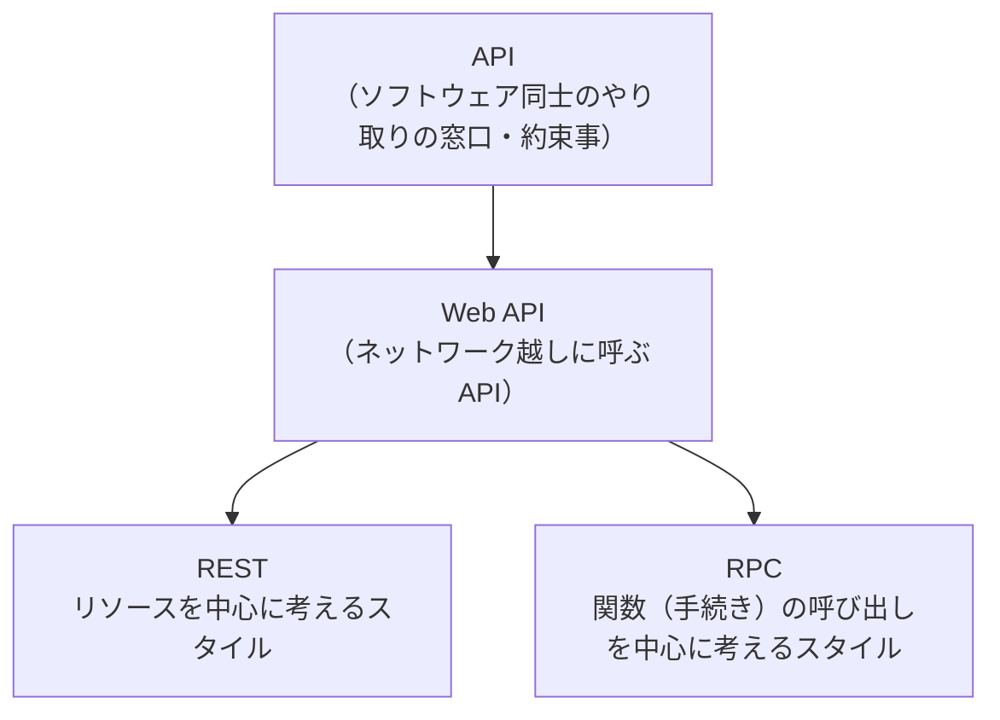

# はじめに

「API」「RPC」「REST」は、どれもよく目にする言葉です。ただ、並べて説明しようとすると、次のような疑問が出てきて手が止まりました。

- そもそも API と REST と RPC は、**同じ階層の言葉**なの？ それとも別物？
- RPC って、結局どういう呼び出し方のこと？
- REST は「HTTP と JSON を使う API」のことだと思っていたけれど、それで合っている？
- REST と RPC は、実際の書き方でどこがどう違うの？
- 結局、どっちをどういうときに使うの？

<!-- TODO: 筆者本人が実際につまずいた点・調べたきっかけに差し替える（上の疑問リストは仮置き） -->

調べていくと、**「API」は大きな枠で、RPC と REST は API を作るときの“設計の考え方（スタイル）”**と捉えるとつながったので、わかった範囲を共有します。

:::note warn
筆者はAPI設計の専門家ではなく、公式ドキュメントや仕様を読んで理解した立場で書いています。「REST」の解釈は人や現場によって幅があるため、ここに書いたのは一つの整理の仕方です。誤りがあればコメントでご指摘いただけると助かります。
:::

# 先に結論

3つは同じ階層の言葉ではなく、次のような関係だと理解しました。



| 言葉 | 一言でいうと | 何の話か |
| --- | --- | --- |
| API | ソフトウェア同士がやり取りするための窓口と約束事 | **概念（大きな枠）** |
| RPC | 遠くにある関数を、手元の関数のように呼ぶ | **設計の考え方**（gRPC や JSON-RPC など具体的な仕様もある） |
| REST | 「リソース」を URL で表し、HTTP の操作で扱う | **設計の考え方（アーキテクチャスタイル）** |

# わからなかったこと①：APIとRESTとRPCは、同じ階層の言葉なの？

「API / REST / RPC」と並べて書かれることが多いので、同じ種類の選択肢だと思い込んでいました。

## 調べてわかったこと

**API（Application Programming Interface）** は、「あるソフトウェアが、別のソフトウェアの機能を使うための窓口と、その使い方の約束事」のことです。ライブラリの関数、OS の機能、Web サービスの URL など、どれも API と呼べます。

その中で、**ネットワーク越しに呼び出すもの**を、ここでは Web API と呼ぶことにします。Web API を作るときに「どういう形にするか」の考え方がいくつかあり、その代表例が **RPC** と **REST** でした。

つまり、

- API：やり取りする窓口そのもの（何を作るか）
- RPC / REST：その窓口を**どういう発想で設計するか**（どう作るか）

という関係だと理解しました。ここがわかると、「APIかRESTか」という比べ方は少しずれていて、「**どんな API を、RPC 風に作るか、REST 風に作るか**」が本来の比べ方なのだと気づきました。

:::note info
ほかにも、GraphQL のように「クライアントが欲しいデータの形を指定する」スタイルもあります。今回は扱いません。
:::

# わからなかったこと②：RPCって、どういう呼び出し方のこと？

## 調べてわかったこと

**RPC（Remote Procedure Call）** は、名前のとおり「遠く（リモート）にある手続き（関数）を呼ぶ」仕組みです。ポイントは、**呼ぶ側からは、普通の関数呼び出しのように見える**ことです。

```python
# 手元の関数を呼ぶ
user = get_user(42)

# RPC：中身はネットワーク越しだが、書き味はほぼ同じ
user = user_service.get_user(42)
```

実装としては、いくつかの種類があります。

| 種類 | 特徴 |
| --- | --- |
| **JSON-RPC** | メソッド名と引数を JSON で送る、軽量な仕様（仕様書では "stateless, light-weight" と説明されている） |
| **gRPC** | Google 発の RPC フレームワーク。`.proto` ファイルで関数と型を定義し、そこからコードを生成する。通信は HTTP/2、データ形式は Protocol Buffers が基本 |

gRPC では、たとえばこのように「関数」を定義します。

```proto
service UserService {
  rpc GetUser (GetUserRequest) returns (User);
}
```

**URL（リソース）ではなく、「GetUser という操作」が中心にある**のが RPC の特徴だと感じました。

# わからなかったこと③：RESTは「HTTPとJSONを使うAPI」のことじゃないの？

最初は、REST を「HTTP でやり取りして JSON を返す API」くらいに捉えていました。

## 調べてわかったこと

REST（Representational State Transfer）は、Roy Fielding 氏の博士論文で提案された**アーキテクチャスタイル（設計の制約の集まり）**で、特定のプロトコルや形式の名前ではありません。論文では、次のような制約を組み合わせたものとして説明されています。

| 制約 | 自分の言葉での理解 |
| --- | --- |
| クライアント・サーバー | 画面側とデータ側を分ける |
| ステートレス | サーバーはリクエスト間の状態を覚えず、1回のリクエストに必要な情報がすべて入っている |
| キャッシュ可能 | レスポンスがキャッシュしてよいかを示せる |
| **統一インターフェース** | どのリソースも同じ流儀（URL と共通の操作）で扱える |
| 階層化システム | 間にプロキシなどを挟んでも成り立つ |

論文でも、REST を他のスタイルから区別する特徴は**統一インターフェースを重視していること**だとされています。Web API の文脈では、これを「**URL でリソースを表し、HTTP のメソッドで操作する**」形で実現することが多いようです。

| 操作 | HTTP メソッド | 例 |
| --- | --- | --- |
| 取得 | `GET` | `GET /users/42` |
| 作成 | `POST` | `POST /users` |
| 更新（置き換え） | `PUT` | `PUT /users/42` |
| 削除 | `DELETE` | `DELETE /users/42` |

:::note warn
実務で「REST API」と呼ばれているものは、論文の制約をすべて満たしているとは限らないと理解しています（たとえば、レスポンスの中に次に辿れるリンクを含める、といった部分は省略されがちです）。そのため、「厳密な REST」と「REST っぽい HTTP API（RESTful と呼ばれることも多い）」は分けて考えたほうが混乱しにくいと感じました。
:::

# わからなかったこと④：RESTとRPCは、実際の書き方でどこが違うの？

ここまでは言葉の説明だったので、同じ機能を両方で書いて比べてみました。

## 調べてわかったこと

「ユーザー 42 の情報を取得する」「ユーザーを削除する」を、それぞれのスタイルで表すとこうなります。

| やりたいこと | REST 風 | RPC 風（HTTP + JSON の場合） |
| --- | --- | --- |
| ユーザー取得 | `GET /users/42` | `POST /getUser` ＋ `{"id": 42}` |
| ユーザー作成 | `POST /users` | `POST /createUser` |
| ユーザー削除 | `DELETE /users/42` | `POST /deleteUser` ＋ `{"id": 42}` |
| 中心にあるもの | **名詞（リソース）** | **動詞（操作）** |

違いを整理すると、次のようになりました。

| 観点 | REST | RPC（例：gRPC） |
| --- | --- | --- |
| 発想 | 「何を」扱うか（リソース） | 「何をする」か（関数） |
| 操作の表し方 | HTTP メソッド（GET / POST…）で共通化 | 関数名ごとに自由に定義 |
| データ形式 | JSON が多い（ただし決まりではない） | gRPC なら Protocol Buffers（バイナリ） |
| 型・契約 | OpenAPI などで別途定義することが多い | `.proto` で定義し、コードを自動生成できる |
| キャッシュとの相性 | `GET` は HTTP のキャッシュに乗せやすい | 基本は `POST` 相当で、HTTP キャッシュは使いにくい |

ここで、前に出てきた「**統一インターフェース**」の意味が腑に落ちました。REST は「どのリソースも `GET` / `POST` / `PUT` / `DELETE` で扱う」と決めることで、**使う側が API ごとに操作名を覚えなくてよい**ようにしているのだと理解しました。一方 RPC は、操作名を自由につけられる分、**やりたいことに素直に書ける**反面、API ごとに覚える操作が増えます。

:::note info
HTTP メソッドには「何度送っても結果が同じ（べき等）」という性質があり、`GET` / `PUT` / `DELETE` はべき等、`POST` は一般にべき等ではない、と MDN では説明されています。REST 風に作ると、**通信が失敗したときに再送してよいか**が、メソッドを見れば判断しやすくなるのも利点だと感じました。
:::

# わからなかったこと⑤：結局、どちらをどういうときに使えばいいの？

## 調べてわかったこと

調べた範囲では、「どちらが優れている」ではなく、**向き不向き**で選ぶという整理が多いようでした。以下は筆者の理解です。

| 状況 | 向いていそうなほう | 理由（自分の理解） |
| --- | --- | --- |
| 外部に公開する API | REST 風 | HTTP と JSON はどの言語・環境でも扱いやすく、利用者が試しやすい |
| 「リソースの取得・作成・更新・削除」が中心 | REST 風 | 操作が `GET` / `POST` / `PUT` / `DELETE` にきれいに対応する |
| 社内のマイクロサービス同士の通信 | RPC（gRPC など） | 型付きの契約とコード生成で、サービス間のずれを防ぎやすい。バイナリで効率もよい |
| 「承認する」「再計算する」など、**操作そのもの**が中心 | RPC 風 | 無理にリソースに見立てるより、動詞のまま書いたほうが素直 |

:::note warn
gRPC は HTTP/2 の機能を前提にしているため、**ブラウザから直接呼ぶのは難しく**、gRPC-Web のような仕組みを挟むのが一般的、と理解しています。ブラウザ向けの API で gRPC を選ぶときは、この点の確認が必要そうです。
:::

実際には、**外向けは REST 風、内部は gRPC** のように、同じシステムの中で使い分けることもあるようです。

# まだ腑に落ちていないこと

- **「REST らしさ」の線引き**：どこまで満たせば REST と呼んでよいのか、現場での合意の取り方がまだ感覚としてつかめていません。
- **リソースに見立てにくい操作の設計**：「承認」「キャンセル」のような操作を、REST 風でどう表すのが良いのか（`POST /orders/42/cancel` のような形が多いと聞きますが、深く調べられていません）。
- **性能差の実感**：gRPC（バイナリ）と JSON の速度差は、実際のアプリでどのくらい効くのか、自分で測っていません。
- **GraphQL との比較**：今回は扱えていません。

# まとめ

- **API** は、ソフトウェア同士がやり取りする窓口と約束事。**REST と RPC は、その窓口を作るときの設計の考え方**で、同じ階層で比べるものではない
- **RPC** は「遠くの関数を、手元の関数のように呼ぶ」発想。gRPC や JSON-RPC などの実装がある
- **REST** は「リソースを URL で表し、共通の操作で扱う」アーキテクチャスタイル。「HTTP + JSON の API」という意味ではない
- 書き方の違いは、**REST は名詞（リソース）中心、RPC は動詞（操作）中心**
- 使い分けは、**外部公開・リソース中心なら REST 風、内部通信・操作中心なら RPC** が目安（筆者の理解）

最初は「APIとRESTとRPC」を横に並べて悩んでいましたが、**API は枠、REST と RPC はその中の設計スタイル**と縦に並べ直したら、すっきり整理できました。

# 参考

- [Architectural Styles and the Design of Network-based Software Architectures（REST の章）- Roy Fielding](https://ics.uci.edu/~fielding/pubs/dissertation/rest_arch_style.htm)
- [Introduction to gRPC](https://grpc.io/docs/what-is-grpc/introduction/)
- [JSON-RPC 2.0 Specification](https://www.jsonrpc.org/specification)
- [REST - MDN Web Docs Glossary](https://developer.mozilla.org/en-US/docs/Glossary/REST)
- [Idempotent - MDN Web Docs Glossary](https://developer.mozilla.org/en-US/docs/Glossary/Idempotent)
