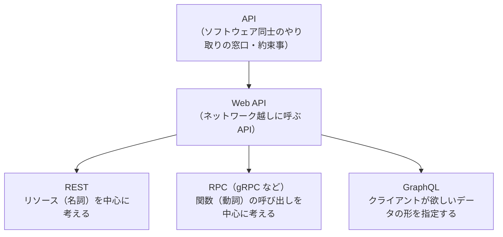

# はじめに

インターンで、初めて **gRPC** と **GraphQL** に触れました。それまでの個人開発では、REST API を実装して、Postman で動作確認する、という進め方しかしたことがありませんでした。

<!-- TODO(実体験): 実際にインターンで何に戸惑ったか（例：コードのどこを見て・何を叩こうとして・どこで手が止まったか）を1〜2文で書く。社内の情報は出さず、一般化して書くこと -->

調べたいことを整理すると、こうなります。

- REST・gRPC・GraphQL は、同じ「API」として並べて比べていいものなの？
- gRPC は、REST と何が違うの？ Postman や curl でそのまま叩けるの？
- GraphQL は、REST と何が違うの？
- 結局、どれをどういうときに使うの？

<!-- TODO(仮置き): 上の疑問リストは、本文の内容から推測した仮置き。筆者本人が実際に感じた疑問に差し替える -->

この記事では、REST しか知らない状態から、手を動かして違いを確かめた範囲を共有します。

:::note warn
筆者は API 設計の専門家ではなく、公式ドキュメントと自分で試した範囲で理解した立場で書いています。「REST」の解釈は人や現場によって幅があるため、ここに書いたのは一つの整理の仕方です。誤りがあればコメントでご指摘いただけると助かります。
:::

# 先に結論

REST・gRPC・GraphQL は、「ネットワーク越しに API を呼ぶ」という同じ目的に対する、**設計の考え方の違い**だと理解しました。



| 観点 | REST | gRPC | GraphQL |
| --- | --- | --- | --- |
| 中心にあるもの | リソース（名詞） | 関数（動詞） | クライアントが指定するデータの形（スキーマの範囲内） |
| エンドポイント | リソースごとの URL | サービス名とメソッド名ごと | 基本は1つ（`/graphql` など） |
| 操作の表し方 | HTTP メソッド | `rpc` で定義したメソッド | `query` / `mutation` |
| 型・契約 | OpenAPI などで別途定義することが多い | `.proto` | スキーマ |
| データ形式 | JSON が多い | Protocol Buffers（バイナリ） | JSON |
| 手元で試す方法 | curl / Postman | grpcurl / Postman（gRPC） | curl（POST）/ Postman（GraphQL） |

## たとえるなら：レストランの注文

表だけだとピンとこなかったので、自分なりにレストランの注文にたとえて整理しました。お店の注文窓口が API、お客さんがクライアント、厨房がサーバーです。

- **REST ＝ セットメニュー**：「A定食」「B定食」のように、店が決めた内容を頼みます。どの料理も「注文する・変更する・取り消す」という共通の言い方で頼めます（`GET` / `POST` / `PUT` / `DELETE`）。出てくる中身は、定食ごとに店が決めています。
- **gRPC ＝ 厨房への指示書**：「焼く」「茹でる」のような操作ごとに、渡す材料（引数）と出てくるもの（戻り値）が、指示書で厳密に決まっています。お客さん側と厨房側が、同じ指示書（`.proto`）を持っているイメージです。
- **GraphQL ＝ 単品メニューから選ぶ注文**：「ご飯と味噌汁と焼き魚」のように、好きな組み合わせを1回の注文で頼めます。ただし、選べるのは**メニュー表（スキーマ）に載っているものだけ**です。

| たとえ語 | 技術用語 |
| --- | --- |
| お店の注文窓口 | API |
| お客さん / 厨房 | クライアント / サーバー |
| 注文 / 出てくる料理 | リクエスト / レスポンス |
| セットメニュー | REST のエンドポイント（URL）ごとに決まった返し方 |
| 厨房への指示書 | gRPC の `.proto` |
| 単品メニュー表 | GraphQL のスキーマ |
| 単品の組み合わせ注文 | GraphQL のクエリ |

:::note info
たとえはあくまで理解の入口で、実際の API とは違う点もあります。たとえば、REST でも `?fields=name,email` のように、項目を絞れる API があります。逆に GraphQL でも、メニュー（スキーマ）にないものは頼めず、エラーになります。細かい仕様は、このあとの各節で確認します。
:::

<!-- TODO(確認): このレストランのたとえが、筆者本人の理解に合っているか確認する。しっくりこなければ別のたとえ（郵便局、図書館など）に差し替える -->

# わからなかったこと①：REST・gRPC・GraphQLは、同じ階層の言葉なの？

REST しか触っていなかったので、「API = REST」くらいの感覚でした。gRPC や GraphQL は、REST の次に覚える別の技術なのだろう、と思っていました。

## 調べてわかったこと

**API（Application Programming Interface）** は、「あるソフトウェアが、別のソフトウェアの機能を使うための窓口と、その使い方の約束事」のことです。そのうち**ネットワーク越しに呼び出すもの**を、ここでは Web API と呼びます。

REST も gRPC も GraphQL も、この Web API を**どういう発想で作るか**の違いでした。つまり、「API か REST か」ではなく、「どんな API を、どの発想で作るか」が本来の比べ方のようです。

もう一つ、自分の思い込みもここで直りました。REST を「HTTP でやり取りして JSON を返す API」のことだと思っていましたが、REST（Representational State Transfer）は Roy Fielding 氏の博士論文で提案された**アーキテクチャスタイル（設計の制約の集まり）**で、プロトコルやデータ形式の名前ではありません。論文では、REST を他のスタイルと区別する特徴は**統一インターフェースを重視していること**だとされています。Web API では、これを「**URL でリソースを表し、HTTP のメソッドで操作する**」形で実現することが多いようです。

:::note warn
実務で「REST API」と呼ばれているものは、論文の制約をすべて満たしているとは限らないと理解しています。「厳密な REST」と「REST っぽい HTTP API（RESTful と呼ばれることも多い）」は分けて考えたほうが混乱しにくいと感じました。
:::

# わからなかったこと②：gRPCは、RESTと何が違うの？ そのまま叩ける？

## 調べてわかったこと

gRPC は **RPC（Remote Procedure Call）** の一種で、「遠くにある関数を、手元の関数のように呼ぶ」発想です。URL（リソース）ではなく、「`SayHello` という操作」が中心にあります。

```python
# 手元の関数を呼ぶ
user = get_user(42)

# RPC：中身はネットワーク越しだが、書き味はほぼ同じ
user = user_service.get_user(42)
```

gRPC では、`.proto` ファイルで関数と型を定義します。公式のサンプル（helloworld）はこの形です。

```proto
package helloworld;

service Greeter {
  rpc SayHello (HelloRequest) returns (HelloReply) {}
}

message HelloRequest {
  string name = 1;
}

message HelloReply {
  string message = 1;
}
```

この `.proto` が、さきほどのたとえでいう「**厨房への指示書**」です。「`SayHello` という操作には、`name` を渡すと `message` が返ってくる」と、お客さん側と厨房側の両方が同じ指示書で確認できます。ここから各言語のコードが自動生成されます。通信は HTTP/2、データ形式は Protocol Buffers（バイナリ）が基本です。

「同じことを REST で書いたら」と並べると、中心にあるものが違うことがわかります。

| やりたいこと | REST 風 | RPC 風 |
| --- | --- | --- |
| ユーザー取得 | `GET /users/42` | `GetUser`（`{"id": 42}` を渡す） |
| ユーザー削除 | `DELETE /users/42` | `DeleteUser`（`{"id": 42}` を渡す） |
| 中心にあるもの | **名詞（リソース）** | **動詞（操作）** |

REST の「統一インターフェース」は、どのリソースも `GET` / `POST` / `PUT` / `DELETE` で扱うと決めることで、**使う側が API ごとに操作名を覚えなくてよい**ようにする考え方だと理解しました。RPC は操作名を自由につけられる分、やりたいことに素直に書けますが、API ごとに覚える操作が増えます。

## 試してみた：RESTはcurlで、gRPCはgrpcurlで

REST 側は、これまで Postman でやっていたことを curl でそのまま再現できます。

```bash
curl -i https://jsonplaceholder.typicode.com/users/1
```

<!-- TODO(実測): 上の実行結果（ステータス行・ヘッダー・本文の冒頭）を貼る。実施日も書く -->

gRPC 側は、公式の helloworld サンプルをローカルで動かし、[grpcurl](https://github.com/fullstorydev/grpcurl) で呼びました。

```bash
# helloworld.proto を指定して SayHello を呼ぶ
grpcurl -plaintext -proto helloworld.proto \
  -d '{"name": "world"}' \
  localhost:50051 helloworld.Greeter/SayHello
```

<!-- TODO(実測): 実際に実行できたコマンドと出力を貼る。事前に未実行のコマンドなので、手順が違えば直す（サーバーの起動方法、grpcurl のインストール方法も書く） -->
<!-- TODO(実測): `.proto` を渡さずに叩いたらどうなるか（サーバーが reflection を有効にしていない場合）の出力 -->
<!-- TODO(実体験): 「ここが REST と違って戸惑った」点を、実際の感想で書く。たとえば、curl で直接叩けない・`.proto` が必要・レスポンスが人間に読めない、など、実際に感じたことだけを書く -->

gRPC がどう HTTP に乗るかを調べると、`POST /パッケージ名.サービス名/メソッド名`（例：`/helloworld.Greeter/SayHello`）のような形でリクエストされる、と gRPC の HTTP/2 プロトコル仕様に書かれていました。URL に操作名が入っているので、REST のように `GET` / `DELETE` で意味を表すのとは、考え方が違うことがわかります。

:::note warn
gRPC は HTTP/2 の機能を前提にしているため、**ブラウザから直接呼ぶのは難しく**、gRPC-Web のような仕組みを挟むのが一般的、と理解しています。ブラウザ向けの API で gRPC を選ぶときは、この点の確認が必要そうです。
:::

# わからなかったこと③：GraphQLは、RESTと何が違うの？

## 調べてわかったこと

GraphQL は、**クライアントが欲しいデータの形（フィールド）をクエリで指定する**スタイルです。公式のドキュメントでは、HTTP で提供する場合、基本は**1つのエンドポイント**（`/graphql` で終わることが多い）に対して、`query` と `mutation` を **POST** で送ると説明されています（`query` に限り GET も許されています）。

たとえるなら、単品メニューから好きな組み合わせで頼める注文です。ただし、**何でも自由に頼めるわけではありません**。サーバー側が**スキーマ**（どんな型・フィールド・クエリがあるかを書いた「メニュー表」）を先に定義していて、クライアントが選べるのはその範囲だけです。サーバーが臨機応変に何かをしているのではなく、クエリに書かれた各フィールドを、あらかじめ決めた処理で埋めて返しています。

つまり、違いは「**レスポンスの形を誰が決めるか**」です。REST や RPC では、サーバー（API の設計者）が URL やメソッドごとに決めます。GraphQL では、**スキーマの範囲内で**クライアントが決めます。

REST との違いを、取得するデータで比べるとこうなります。

| | REST | GraphQL |
| --- | --- | --- |
| 取得する項目の決め方 | サーバー側が返す形を決める（URL ごと） | **スキーマの範囲内で**、クライアントがクエリで指定する |
| 項目を増やしたいとき | API の変更や別 URL が必要になることがある | クエリに項目を書き足す |
| 複数リソースの取得 | リクエストを複数回に分けることがある | 1回のクエリで関連データをまとめて取れる |

<!-- TODO(確認): 上の表の「REST は〜することがある」は、一般的な説明を自分の言葉に直したもの。実際の体験（インターンで感じたこと）と合っているか確認し、合わなければ直す -->

## 試してみた：欲しい項目を増やしてみる

公開されている GraphQL API（Countries API）に、curl で POST してみました。まず、国名と首都だけを取得します。

```bash
curl -s -X POST https://countries.trevorblades.com/ \
  -H 'Content-Type: application/json' \
  -d '{"query": "{ country(code: \"JP\") { name capital } }"}'
```

<!-- TODO(実測): 上の実行結果を貼る -->

次に、**URL（エンドポイント）はそのまま**で、クエリの中身だけに `currency`（通貨）と `languages`（言語）を足します。

```bash
curl -s -X POST https://countries.trevorblades.com/ \
  -H 'Content-Type: application/json' \
  -d '{"query": "{ country(code: \"JP\") { name capital currency languages { name } } }"}'
```

<!-- TODO(実測): 上の実行結果を貼る。1回目との違い（項目が増えただけで、URL・メソッドは同じ）を確認する -->
<!-- TODO(実体験): 「REST なら、この変更はどうなるか」を自分の個人開発の経験と比べて、感想を書く -->

ただし、**スキーマにない項目は頼めません**。存在しないフィールド（ここでは `population`）を指定してみます。

```bash
curl -s -X POST https://countries.trevorblades.com/ \
  -H 'Content-Type: application/json' \
  -d '{"query": "{ country(code: \"JP\") { name population } }"}'
```

<!-- TODO(実測): 上の実行結果（`Cannot query field "population" on type "Country"` のようなエラー）を貼る。実施日も書く -->

「クライアントが自由に決められる」といっても、選べるのはスキーマに書かれた項目だけで、それ以外はエラーとして返ってくるはずです。実際に試して、「サーバーが決めたメニューの中から選んでいる」感覚を確かめました。

<!-- TODO(実体験): 上の最後の一文の「確かめました」は、筆者が実際に試して感じた内容に合わせて書き直す（感想を捏造しない） -->

<!-- TODO(実体験): Postman の GraphQL 機能で同じことをやってみた感想（curl との違い）。Postman には gRPC・GraphQL 用のリクエスト形式があると公式ドキュメントにあるので、REST の Postman との操作の違いを書く -->

# わからなかったこと④：結局、どれをどういうときに使えばいいの？

## 調べてわかったこと

調べた範囲では、「どれが優れている」ではなく、**向き不向き**で選ぶという整理が多いようでした。以下は筆者の理解です。

| 状況 | 向いていそうなもの | 理由（自分の理解） |
| --- | --- | --- |
| 外部に公開する API、リソースの取得・作成・更新・削除が中心 | REST 風 | HTTP と JSON はどの言語・環境でも扱いやすく、利用者が試しやすい |
| 社内のサービス同士の通信、型を揃えたい | gRPC | 型付きの契約とコード生成で、サービス間のずれを防ぎやすい。バイナリで効率もよい |
| 画面ごとに必要な項目が違う、複数のデータをまとめて取りたい | GraphQL | クライアントが欲しい項目だけ指定できる |
| 「承認する」「再計算する」など、**操作そのもの**が中心 | RPC 風 | 無理にリソースに見立てるより、動詞のまま書いたほうが素直 |

実際には、**外向けは REST 風、内部は gRPC** のように、同じシステムの中で使い分けることもあるようです。レストランのたとえでいえば、お客さんにはわかりやすいセットメニュー（REST）を出し、厨房の中では指示書（gRPC）でやり取りする、というイメージです。

<!-- TODO(実体験): インターン先でなぜ gRPC / GraphQL が使われていたと感じたか（聞いた話・推測）。聞いていない場合は、この段落は書かない -->

# まだ腑に落ちていないこと

- **「REST らしさ」の線引き**：どこまで満たせば REST と呼んでよいのか、現場での合意の取り方がまだ感覚としてつかめていません。
- **性能差の実感**：gRPC（バイナリ）と JSON の速度差は、実際のアプリでどのくらい効くのか、自分で測っていません。
- **GraphQL の運用面**：キャッシュやエラーの扱いなど、実運用でどうなるかは調べられていません。

# まとめ

- REST・gRPC・GraphQL は、**Web API を作るときの設計の考え方の違い**で、「どれか1つが API」というわけではない
- **REST** は「リソースを URL で表し、共通の操作で扱う」アーキテクチャスタイル。「HTTP + JSON の API」という意味ではない
- **gRPC** は「遠くの関数を呼ぶ」発想。`.proto` で型を定義するので、curl のようには叩けず、grpcurl などが必要になる
- **GraphQL** は「クライアントが欲しいデータの形を指定する」発想。基本は1つのエンドポイントに POST する。ただし選べるのは、サーバーが定義した**スキーマの範囲内**だけ
- 使い分けは、**外部公開・リソース中心なら REST、内部通信なら gRPC、画面ごとにデータの形が違うなら GraphQL** が目安（筆者の理解）

<!-- TODO(実体験): 最後の一言。「Postman で REST を叩くだけだった自分が、〇〇に気づいた」など、本人の言葉で締める -->

# 参考

- [Architectural Styles and the Design of Network-based Software Architectures（REST の章）- Roy Fielding](https://ics.uci.edu/~fielding/pubs/dissertation/rest_arch_style.htm)
- [Introduction to gRPC](https://grpc.io/docs/what-is-grpc/introduction/)
- [gRPC over HTTP2](https://github.com/grpc/grpc/blob/master/doc/PROTOCOL-HTTP2.md)
- [helloworld.proto - grpc/grpc](https://github.com/grpc/grpc/blob/master/examples/protos/helloworld.proto)
- [Serving over HTTP - GraphQL](https://graphql.org/learn/serving-over-http/)
- [Manage gRPC APIs using Postman](https://learning.postman.com/docs/sending-requests/grpc/grpc-client-overview/)
- [GraphQL in Postman](https://learning.postman.com/docs/use/send-requests/protocols/graphql/graphql-overview.md)
- [Countries API（実験で使った公開 GraphQL API）](https://countries.trevorblades.com/)
