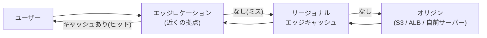
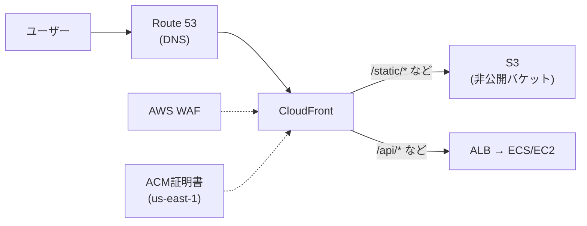
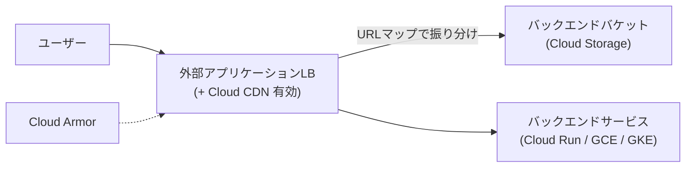

# はじめに

CDN（Content Delivery Network）は「画像やJSを世界中のサーバーにキャッシュして速くする仕組み」と、ざっくり理解していました。ただ、実際に AWS や GCP で構成を考える段になって、次のような疑問が出てきました。

- 「キャッシュを近くに置く」とは、具体的にどういう流れで動いているの？
- CDN を入れると、速くなる以外に何がうれしいの？
- キャッシュされた古いファイルが残り続けたら、どうやって更新するの？
- AWS と GCP で、CDN を使うときのインフラ構成はどう変わるの？
- 両方使っているとき、どう組み合わせるの？

<!-- TODO: 筆者本人が実際につまずいた点・調べたきっかけに差し替える（上の疑問リストは仮置き） -->

用語を調べ直して公式ドキュメントを読んでいくと、**「CDNは何を・どこに・どれだけの間キャッシュするか」を決める仕組み**だと捉えると全体がつながったので、わかった範囲を共有します!!

:::note warn
筆者はCDNやクラウドインフラの専門家ではなく、公式ドキュメントを読んで理解した立場で書いています。料金・仕様・上限値は変わりうるので、実際に使う前に最新の公式ドキュメントを確認してください。誤りがあればコメントでご指摘いただけると助かります!
:::

この記事で扱うサービスは、AWS の **Amazon CloudFront** と、GCP の **Cloud CDN** です。

# 先に結論

CDN は、**オリジン（本来のサーバー）の前に置く「世界中に分散したキャッシュ付きの中継サーバー群」**です。

```text
CDNなし：ユーザー ───────────────────────────→ オリジン（遠い・全リクエストを処理）
CDNあり：ユーザー → 近くのエッジ（キャッシュあれば即返す）→ なければオリジンへ
```

| 比較項目 | AWS（CloudFront） | GCP（Cloud CDN） |
| --- | --- | --- |
| CDN単体で使える？ | ディストリビューションを作れば単体で使える | **ロードバランサに設定として付ける**形 |
| 静的ファイルの置き場所 | S3 | Cloud Storage（バックエンドバケット） |
| 非公開バケットへの制限 | OAC（Origin Access Control） | バケットのIAM／署名付きURLなど |
| 独自ドメインのHTTPS証明書 | ACM（**us-east-1** のもの） | ロードバランサ側で設定 |
| キャッシュの強制更新 | Invalidation | Cache invalidation |

# わからなかったこと①：「キャッシュを近くに置く」って、実際どう動いているの？

「近くにある」と言われても、ユーザーがどうやって近くのサーバーにたどり着くのかが、正直ピンときませんでした。

## 調べてわかったこと

CloudFront の公式ドキュメントでは、ユーザーのリクエストは **DNS によって、遅延が小さいと思われる拠点（エッジロケーション／POP）に振り分けられる**と説明されています。そこにキャッシュがあればそのまま返し、なければ奥へ取りに行きます。



CloudFront では、エッジの奥に **リージョナルエッジキャッシュ**（エッジより大きなキャッシュ）があり、さらに任意で **Origin Shield**（オリジンの手前に1か所だけ置く追加のキャッシュ層）を有効にできます。Origin Shield を使うと、同じファイルへのリクエストがまとめられて、オリジンへの問い合わせが最小で1回になることがあるそうです。

GCP の Cloud CDN も考え方は同じで、Google のエッジ側のサーバーでキャッシュを確認し、**ヒットすればそのまま返し、ミスならロードバランサ経由でオリジンに取りに行き、レスポンスがキャッシュ可能なら保存する**、という流れでした。

:::note info
意外だったのは、**すべてのリクエストがキャッシュ経由になるわけではない**ことです。CloudFront では `PUT` / `POST` / `PATCH` / `DELETE` などの書き込み系メソッドは、エッジからそのままオリジンに送られます。CDN が得意なのは、あくまで「同じ内容を何度も返すリクエスト」だと理解しました。
:::

## 「キャッシュする・しない」は何で決まるの？

ここが次の疑問につながります。キャッシュの判断は、基本的に**オリジンが返す HTTP ヘッダー**（`Cache-Control` など）と、CDN 側の設定（TTL やキャッシュキー）で決まります。

- **TTL（Time To Live）**：キャッシュを保持する時間のことです。
- **キャッシュキー**：「同じリクエスト」とみなす条件のことです。Cloud CDN では既定でURL全体が使われ、設定で変えられます。

# わからなかったこと②：CDNを入れると、速くなる以外に何がうれしいの？

「速くなる」は理解していましたが、それだけだと導入の理由として弱い気がして、他の利点を調べました。

## 調べてわかったこと

整理すると、次の4つにまとまりました。

| 利点 | 中身 |
| --- | --- |
| **表示が速くなる** | ユーザーに近い拠点から返せるので、距離による遅延が小さくなる |
| **オリジンの負荷が下がる** | キャッシュヒットした分、オリジンへのリクエストが減る |
| **急なアクセス増に強くなる** | 負荷をエッジ側が受け止めるため、オリジンまで届くリクエストが減る |
| **セキュリティ機能を手前に置ける** | WAF（Webアプリ向けファイアウォール）などをエッジ側で適用できる |

<!-- TODO: 筆者が実際に感じた効果・数値（表示速度、オリジン負荷など）があれば追記する -->

ポイントは、**このうち上の3つは「キャッシュヒット率が高いほど効く」**ことです。つまり、利点を引き出せるかどうかは、次の「どれだけ上手にキャッシュさせるか」にかかっているように感じました。

:::note warn
「CDNを入れれば必ず速くなる」とは言い切れないと理解しています。キャッシュできない動的なレスポンスばかりだと、ヒット率が低く、効果は限定的になるはずです。
:::

# わからなかったこと③：古いキャッシュが残り続けたら、どうやって更新するの？

導入前、いちばん不安だったのがこれでした。画像を差し替えたのに、ユーザーには古いままのものが表示され続けるのでは、と思ったからです。

## 調べてわかったこと

対処は、大きく3つあると理解しました。

1. **TTL を短めにする**：時間が経てば勝手に期限切れになります。CloudFront では、キャッシュポリシーを使わない場合の既定 TTL は24時間と説明されています。Cloud CDN は、オリジンがキャッシュ用のヘッダーを返さないとき、既定で1時間（3600秒）キャッシュするようです（どちらもオリジンのヘッダーや設定で変わります）。
2. **ファイル名やURLにバージョンを入れる**（例：`app.3f2a9c.js`）：内容が変わればURLが変わるので、古いキャッシュを気にしなくて済みます。
3. **無効化（Invalidation）する**：キャッシュを明示的に消します。パスのパターン（例：`/images/*`）で指定できます。

```bash
# CloudFront の例
aws cloudfront create-invalidation \
  --distribution-id EXXXXXXXXXXXX \
  --paths "/images/*"

# Cloud CDN の例
gcloud compute url-maps invalidate-cdn-cache MY_URL_MAP \
  --path "/images/*"
```

AWS の公式ドキュメントでは、**無効化パスは月1,000件までは無料、超えた分は課金**と説明されています（確認時点。料金は変わりうるので最新を確認してください）。また、ワイルドカード（`/images/*`）は1パスとして数えられます。AWS は費用面からも、無効化に頼りすぎず `Cache-Control` やURLのバージョニングで管理することを勧めています。

:::note info
Cloud CDN のドキュメントで印象に残ったのは、**Cloud CDN を無効にしても、キャッシュは消えない**という点です。誤って非公開のコンテンツがキャッシュされた場合は、先にオリジン側を直してから無効化する、という順序が書かれていました。
:::

<!-- TODO: 上の「無効にしてもキャッシュは消えない」「先にオリジンを直す」は、今回の再確認（caching / cache-invalidation-overview / overview ページ）で該当記述を見つけられなかった。出典ページを特定して参考欄に追加するか、確認できなければ削除する -->
<!-- TODO: ①「正直ピンときませんでした」、③「導入前、いちばん不安だった」、⑤「最初に戸惑った」は仮の書き方。筆者本人の実際のつまずきに差し替える -->
<!-- TODO: 図中の「\n」は Qiita の mermaid で改行されない可能性がある。既存記事に合わせて <br/> に統一するか、プレビューで確認する -->


# わからなかったこと④：AWSでCDNを使うと、インフラ構成はどうなるの？

## 調べてわかったこと

Webサイトの静的ファイル配信を想定すると、基本形は次のとおりです。



構成のポイントは次のとおりです。

- **S3 は非公開のままにして、CloudFront 経由だけで見せる**：CloudFront の **OAC（Origin Access Control）** を使い、バケットポリシーで「このディストリビューションからのアクセスだけ許可」します。これで、S3 のURLを直接叩かれるのを防げます。以前は OAI（Origin Access Identity）という仕組みが使われていましたが、現在は OAC が推奨されています。
- **HTTPS 証明書は ACM の `us-east-1`（バージニア北部）で発行する**：CloudFront では、これ以外のリージョンの証明書は使えません。東京リージョンで作ってしまって、ディストリビューションに設定できず戸惑う、というのはありがちなつまずきだと思いました。
- **パスごとにオリジンを分けられる**：`/static/*` は S3、`/api/*` は ALB（Application Load Balancer）といった振り分けができます。API側はキャッシュしない（または短くする）設定にします。
- **WAF や Shield といった保護を手前に置ける**：オリジンに届く前にエッジで防げます。

<!-- TODO: 筆者が実際に構築した/つまずいた構成があれば差し替える。特にACMのリージョン、OACの設定など -->

# わからなかったこと⑤：GCPだと構成はどう違う？ 両方使うときは？

## GCPの場合

GCP で最初に戸惑ったのは、**Cloud CDN は単体のサービスとして作るのではなく、ロードバランサの設定として有効にする**ことでした。公式ドキュメントでも、Cloud CDN はグローバル外部アプリケーションロードバランサと連携して動く、と説明されています。



- **URL マップ**でパスごとに、**バックエンドバケット**（Cloud Storage）か**バックエンドサービス**（アプリ側）に振り分けます。CDN はそのバックエンド単位で有効にします。
- キャッシュの挙動は **キャッシュモード**で選びます。
  - `CACHE_ALL_STATIC`：静的らしいコンテンツを自動でキャッシュ（新規バックエンドの既定）
  - `USE_ORIGIN_HEADERS`：オリジンのヘッダーに従う
  - `FORCE_CACHE_ALL`：オリジンの指示を無視して、成功レスポンスをすべてキャッシュ
- `FORCE_CACHE_ALL` は便利そうですが、**ユーザーごとに内容が違うレスポンスまでキャッシュしてしまう危険**があると公式にも注意書きがあります。
- 限定公開のコンテンツには **署名付きURL / 署名付きCookie** が使えます。公開と非公開のコンテンツは、バケットを分けるのが推奨されています。

## 両方使うとき（マルチクラウド）はどうする？

「AWSとGCPを併用する」という言葉には、おそらく次の2パターンがあります。

| パターン | 構成の例 | 気をつけること |
| --- | --- | --- |
| **用途で分ける** | Webサイト・静的配信は AWS（CloudFront + S3）、データ基盤・機械学習は GCP | CDNは基本それぞれ独立。DNS で振り分ければ済む |
| **CDN と オリジンを別クラウドにする** | CloudFront の手前に置き、オリジンは GCP のロードバランサ | CloudFront はカスタムオリジン（任意のHTTPサーバー）を指定できるため構成上は可能だが、クラウド間の通信（転送料・遅延）が発生する |

<!-- TODO: 筆者が想定している併用ケース（例：移行中、冗長化、用途別）に絞って書き直す -->

私の理解では、**どちらか一方のCDNに揃えたほうが運用はシンプル**で、併用は「用途ごとに分ける」のが無理のない形です。2つ目のパターンは、技術的には成立するものの、**公式ドキュメントで構成例を確認できていない**ため、実際にやる場合は料金と遅延を含めて検証が必要だと考えています。

# まだ腑に落ちていないこと

この記事を書いていて、**Valkey（Redis 系のインメモリKVS）のキャッシュと、CDN は、かなり似た感覚なのでは？**という疑問が出てきました。どちらも「遅い・負荷の高い元の場所に何度も取りに行かないよう、手前に速いコピーを置く」仕組みで、TTL で期限を決める点も同じに見えます。

一方で、置く場所（ユーザーの近く / アプリの近く）や、誰がキャッシュを出し入れするか（CDN が自動 / アプリが明示的に操作）は違いそうです。この違いと使い分けは、**次の記事で調べてまとめる予定**です。

# まとめ

- CDN は、オリジンの前に置く**世界中に分散したキャッシュ付き中継サーバー**。DNS で近くの拠点に振り分けられ、キャッシュがあれば即返し、なければオリジンに取りに行く
- 利点は**表示速度、オリジン負荷の軽減、急なアクセス増への強さ、エッジでのセキュリティ**。どれも**ヒット率が高いほど効く**
- 古いキャッシュへの対処は、**TTL・URLのバージョニング・無効化**の3つ
- AWS は **CloudFront + S3（OAC）+ ACM（us-east-1）** が基本形。GCP は **ロードバランサ + Cloud CDN + Cloud Storage** で、CDN は LB の設定として有効にする
- 併用は、**用途で分ける**のが無理のない形

最初は「キャッシュを近くに置く仕組み」くらいの理解でしたが、**何を・どこで・どのくらいの間キャッシュするか**を意識すると、AWS と GCP のどちらの設定項目も同じ地図の上で読めるようになりました。

# 参考

- [How CloudFront delivers content - Amazon CloudFront](https://docs.aws.amazon.com/AmazonCloudFront/latest/DeveloperGuide/HowCloudFrontWorks.html)
- [Use Amazon CloudFront Origin Shield](https://docs.aws.amazon.com/AmazonCloudFront/latest/DeveloperGuide/origin-shield.html)
- [Restrict access to an Amazon S3 origin - Amazon CloudFront](https://docs.aws.amazon.com/AmazonCloudFront/latest/DeveloperGuide/private-content-restricting-access-to-s3.html)
- [Pay for file invalidation - Amazon CloudFront](https://docs.aws.amazon.com/AmazonCloudFront/latest/DeveloperGuide/PayingForInvalidation.html)
- [ViewerCertificate - Amazon CloudFront API Reference](https://docs.aws.amazon.com/cloudfront/latest/APIReference/API_ViewerCertificate.html)
- [Cloud CDN overview - Google Cloud](https://docs.cloud.google.com/cdn/docs/overview)
- [Caching overview - Cloud CDN](https://docs.cloud.google.com/cdn/docs/caching)
- [Change cache modes - Cloud CDN](https://docs.cloud.google.com/cdn/docs/using-cache-modes)
- [Set up a backend bucket - Cloud CDN](https://docs.cloud.google.com/cdn/docs/setting-up-cdn-with-bucket)
- [Cache invalidation overview - Cloud CDN](https://docs.cloud.google.com/cdn/docs/cache-invalidation-overview)
- [Content access control - Cloud CDN](https://docs.cloud.google.com/cdn/docs/authenticate-content)
