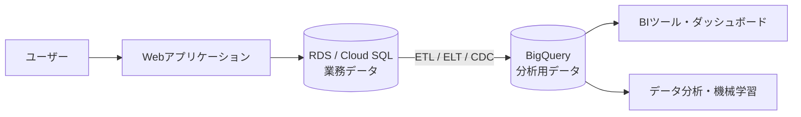
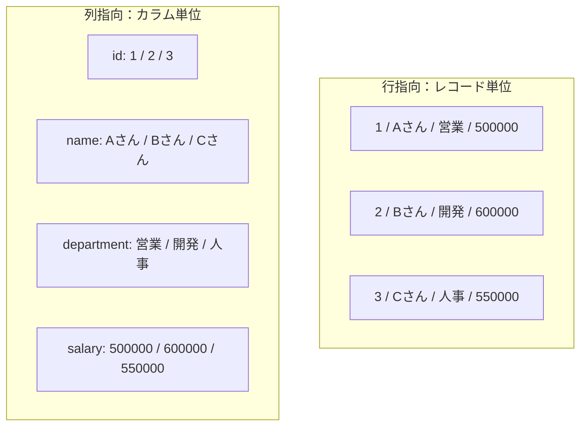
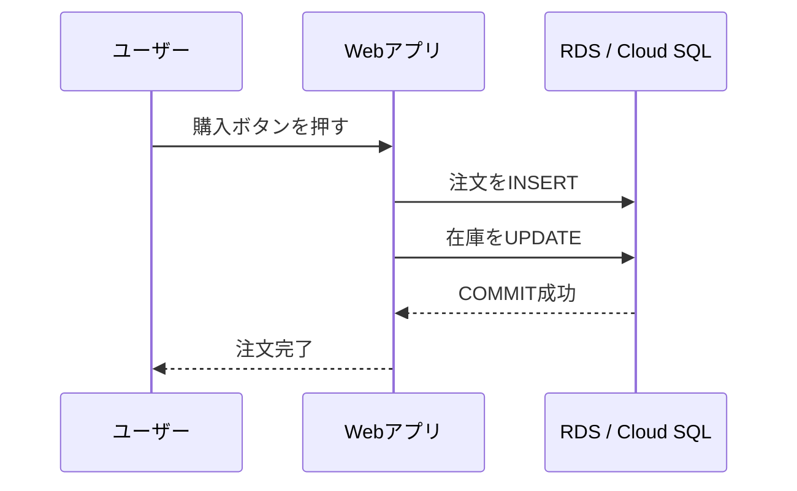
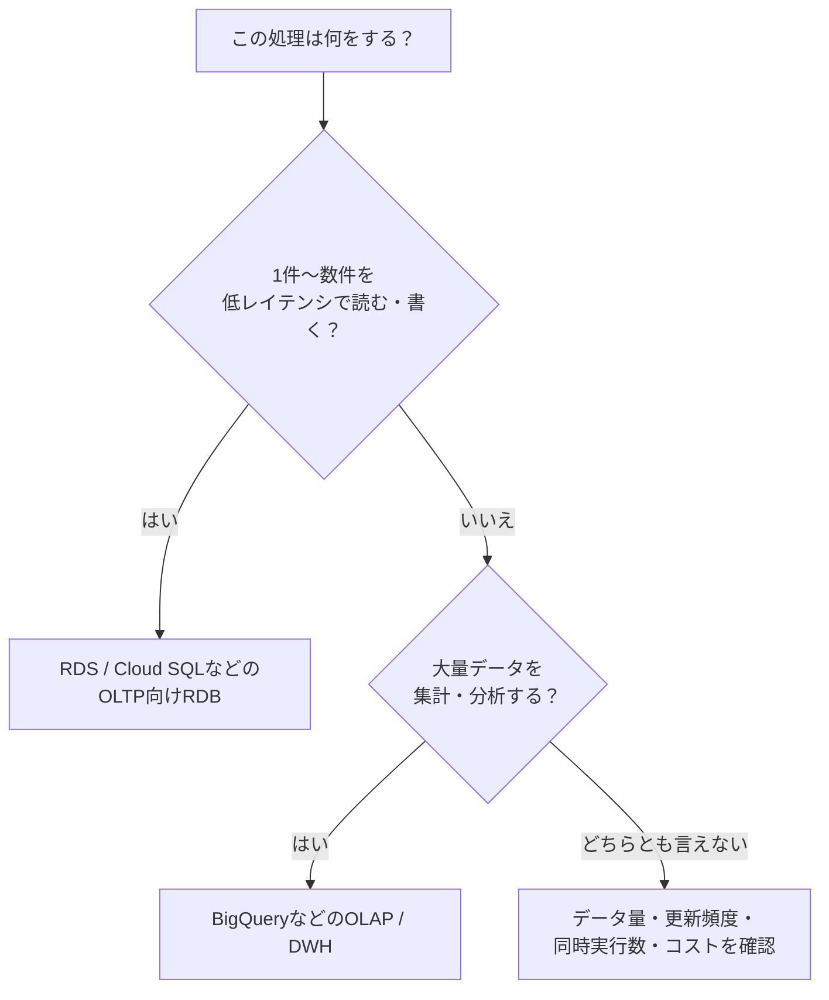

# はじめに

Webアプリケーション開発では、Amazon RDS や Google Cloud SQL（MySQL / PostgreSQL）を使う機会が多いと思います。

一方で、ログ分析やBIツールとの連携をきっかけに BigQuery を使い始めると、次のような疑問が出てきます。

- RDS / Cloud SQL と BigQuery は、どちらもSQLで操作できるのに何が違うのか
- なぜ BigQuery では `SELECT *` を避ける必要があるのか
- RDBで慣れた `UPDATE` や `JOIN` の書き方を、そのまま使ってよいのか
- アプリケーションのデータは、どちらに保存すればよいのか

この記事では、両者を「データの並べ方」と「処理の目的」という2つの軸で整理します。

> この記事でいう RDS / Cloud SQL は、主に MySQL や PostgreSQL のような一般的なリレーショナルデータベースを指します。実際の挙動はデータベースエンジンや設定によって異なります。

## 1. まず結論：得意分野が違う

RDS / Cloud SQL と BigQuery は、どちらが優れているという関係ではありません。そもそも、最適化している仕事が異なります。

| 比較項目 | RDS / Cloud SQL | BigQuery |
| --- | --- | --- |
| 主な役割 | Webアプリケーションの業務データを扱うRDB | 大量データを蓄積・分析するDWH（データウェアハウス） |
| 処理の種類 | **OLTP**（トランザクション処理） | **OLAP**（分析処理） |
| データの傾向 | 行単位の読み書きが多い | 列単位の集計・スキャンが多い |
| 得意な処理 | 1件の検索、登録、更新、削除 | 大量データの集計、分析、BI連携 |
| 重視する性能 | 低レイテンシ、同時実行、整合性 | スループット、大規模スキャン |
| コストの考え方 | インスタンス、ストレージ、I/Oなど | ストレージ、処理量、予約容量など |

一言で表すと、次のようになります。

```text
RDS / Cloud SQL = アプリケーションの「今」を正確に処理する
BigQuery        = 蓄積したデータから「傾向」を大規模に分析する
```

## 2. 全体像：アプリDBと分析基盤を分ける

実際のシステムでは、どちらか一方だけを使うのではなく、役割分担させることがよくあります。



たとえば、ECサイトなら次のような分担です。

- 注文を確定する、在庫を減らす、会員情報を更新する：RDS / Cloud SQL
- 月別売上を集計する、購入傾向を分析する：BigQuery
- BigQueryの分析結果をBIツールで共有する：BigQuery + BIツール

重要なのは、アプリケーションのリクエストから直接 BigQuery を呼び出して、RDBの代わりに使おうとしないことです。分析用の処理が業務トランザクションに影響しないよう、役割を分けます。

## 3. 違い①：行指向と列指向

### 3.1 行指向：1件のデータをまとめて扱う

次のような `employees` テーブルを考えます。

| id | name | department | salary |
| ---: | --- | --- | ---: |
| 1 | Aさん | 営業 | 500000 |
| 2 | Bさん | 開発 | 600000 |
| 3 | Cさん | 人事 | 550000 |

行指向のイメージは、同じレコードの値を近くに置くことです。

```text
1, Aさん, 営業, 500000  ← 1行目
2, Bさん, 開発, 600000  ← 2行目
3, Cさん, 人事, 550000  ← 3行目
```

たとえば、次のように1人の情報を取得する処理に向いています。

```sql
SELECT id, name, department, salary
FROM employees
WHERE id = 2;
```

必要な1行を見つけ、その行に含まれる値をまとめて読み込めばよいからです。1行の登録・更新も、行指向の得意分野です。

RDS / Cloud SQL はデータベースエンジンによって詳細な実装は異なりますが、一般的なトランザクション向けRDBはこのような行単位のアクセスに適しています。

### 3.2 列指向：必要な列を大量に読む

列指向では、同じ列の値をまとめて扱います。

```text
id:         1,       2,       3
name:       Aさん,   Bさん,   Cさん
department: 営業,    開発,    人事
salary:     500000,  600000,  550000
```

たとえば「全社員の平均給与」を求める場合、必要なのは `salary` 列だけです。

```sql
SELECT AVG(salary)
FROM employees;
```

列指向なら、`id` や `name` など、集計に使わない列をできるだけ読み込まずに処理できます。また、同じ列には似た型・似た性質の値が並ぶため、圧縮も効きやすくなります。

BigQueryは、分散処理やストレージとの分離など複数の仕組みで大規模分析を実現していますが、列指向ストレージも重要な要素の一つです。

### 3.3 図で比較する



ただし、「RDSは必ず行指向」「BigQueryは列指向だから常に速い」と単純化しすぎないことも大切です。インデックス、パーティション、クラスタリング、データ量、クエリの内容などによって実際の性能は変わります。

## 4. 違い②：OLTPとOLAP

行指向・列指向の違いは、データベースが想定している処理の違いともつながっています。

### OLTP：細かい処理を安全かつ素早く実行する

OLTP（Online Transaction Processing）は、アプリケーションから発生する日々のトランザクションを処理する方式です。



OLTPで重視されることは次のとおりです。

- 1回の処理対象が1行〜数行であること
- 多数のユーザーからのリクエストを同時に処理できること
- トランザクションの整合性を保つこと
- 必要なレコードを低レイテンシで取得できること

代表的な処理は、会員情報の更新、注文の登録、在庫の減算、決済ステータスの更新などです。

### OLAP：大量データを読み、傾向を見つける

OLAP（Online Analytical Processing）は、蓄積された大量データを集計・分析する方式です。


OLAPで重視されることは次のとおりです。

- 大量の行を効率よくスキャンできること
- 複数のデータを結合・集計できること
- 分析クエリを並列実行できること
- BIツールから繰り返し分析できること

代表的な処理は、日次売上の集計、顧客セグメント分析、アクセスログの分析、広告効果の測定などです。

## 5. BigQueryで特に意識したいこと

### 5.1 `SELECT *` は「便利」でもスキャン量に注意する

BigQueryでは、クエリが参照する列の量が、処理量やコストに影響します。分析に不要な列まで取得する `SELECT *` は、基本的に避ける癖をつけるのがおすすめです。

```sql
-- 必要な列だけを指定する
SELECT
  order_date,
  prefecture,
  amount
FROM `my-project.analytics.orders`
WHERE order_date >= '2026-01-01';
```

`LIMIT 10` を付けても、読み込み対象の列やパーティションが自動的に少なくなるとは限りません。クエリ実行前に「推定処理バイト数」を確認し、必要に応じて最大請求額（Maximum bytes billed）も設定します。

> BigQueryの料金体系は、オンデマンド課金、容量課金（予約・エディション）などの選択肢があります。ここでは、特にオンデマンド課金で意識したい「処理量」を中心に説明しています。

### 5.2 パーティションで読み込む範囲を絞る

日付で分析するテーブルなら、日付列でパーティション分割しておくと、対象期間以外のデータを読み込まずに済みます。

```sql
SELECT
  product_id,
  SUM(amount) AS total_amount
FROM `my-project.analytics.orders`
WHERE order_date BETWEEN '2026-01-01' AND '2026-01-31'
GROUP BY product_id
ORDER BY total_amount DESC;
```

この例では、`order_date` パーティションを適切に利用できる設計になっていることが重要です。パーティション列に関数をかけるなど、絞り込みが効きにくい書き方になっていないかも確認します。

### 5.3 クラスタリングでよく絞り込む列を整理する

パーティションが「大きな期間の単位で分ける」仕組みだとすると、クラスタリングはテーブル内のデータを、よく使う列の値に基づいて整理する仕組みです。

たとえば、日付でパーティション分割したうえで、`customer_id` や `product_id` で絞り込むクエリが多い場合、クラスタリングが有効なことがあります。

```text
パーティション：2026-01、2026-02、2026-03 ...
                  ↓
クラスタリング：customer_id / product_id などでデータを整理
```

どの列を設定すべきかは、実際のクエリパターンと実行計画を見て決めます。設定すれば必ず速くなるわけではありません。

### 5.4 `UPDATE`・`DELETE` はできるが、設計の中心にしない

BigQueryでもDMLによる `UPDATE`、`DELETE`、`MERGE` は利用できます。そのため「更新できないデータベース」という意味ではありません。

ただし、1件ずつ頻繁に更新する処理を大量に発生させると、OLTP向けのRDBほど低レイテンシにはなりません。BigQueryでは、次のような設計が一般的です。

- イベントやログを追記する
- 日次・時間単位でまとめてロードする
- ステージングテーブルから集計テーブルを作り直す
- 必要な場合だけ `MERGE` でまとめて反映する

リアルタイムに注文状態を1件更新する処理はRDBへ、更新履歴を含む大量の注文データを分析する処理はBigQueryへ、という切り分けが基本です。

### 5.5 正規化と非正規化は目的で使い分ける

RDBでは、重複を減らし、整合性を保つためにテーブルを正規化して、必要に応じて `JOIN` する設計がよく使われます。

BigQueryでは、分析時に何度も使う情報をあらかじめまとめておく、あるいは `STRUCT` / `ARRAY` などのネスト構造を使うことで、読み取りを効率化できる場合があります。

```text
RDB：orders ── JOIN ── customers ── JOIN ── products

DWH：分析に必要な注文・顧客・商品情報をまとめた分析用テーブル
```

ただし、BigQueryで常に非正規化すべきという意味ではありません。データの更新頻度、重複量、クエリの複雑さ、運用しやすさを見て判断します。分散処理での `JOIN` も可能なので、まずはクエリの実行計画や処理量を確認することが大切です。

## 6. 同じ要件を両者で書き分ける

### RDS / Cloud SQL：1件の注文を取得する

```sql
SELECT
  id,
  customer_id,
  status,
  total_amount
FROM orders
WHERE id = 12345;
```

アプリケーションのリクエストに対して、主キーやインデックスを使って必要な1件を素早く取得します。

### BigQuery：月別・地域別に売上を集計する

```sql
SELECT
  DATE_TRUNC(order_date, MONTH) AS order_month,
  prefecture,
  SUM(total_amount) AS total_amount,
  COUNT(*) AS order_count
FROM `my-project.analytics.orders`
WHERE order_date >= '2026-01-01'
  AND order_date < '2027-01-01'
GROUP BY order_month, prefecture
ORDER BY order_month, total_amount DESC;
```

こちらは大量の注文データを読み、期間・地域ごとに集計する処理です。BigQueryが得意とする典型的なOLAPクエリです。

## 7. よくある誤解

### 誤解1：BigQueryはRDBの完全な置き換えになる

BigQueryはSQLで操作できますが、Webアプリケーションの主データベースとして、RDBと同じ使い方をするためのサービスではありません。

特に、1件ずつの低レイテンシな更新、多数の同時トランザクション、アプリケーションの強い整合性要件がある場合は、RDS / Cloud SQLのようなOLTP向けデータベースが適しています。

### 誤解2：列指向なら、どんなクエリでも速い

列指向は、必要な列を大量に読む分析に向いています。1件のレコードを頻繁に更新する処理や、複雑な条件で少数行を探す処理が常に得意というわけではありません。

### 誤解3：BigQueryではJOINしてはいけない

BigQueryでも `JOIN` は普通に使えます。ただし、大きなテーブル同士を結合する場合は、結合キー、データ量、事前集計、パーティション、クラスタリングを考えます。

「JOIN禁止」ではなく、「分析の都度、巨大なJOINを繰り返さなくてよいデータモデルを検討する」が現実的です。

## 8. 迷ったときの使い分け

次のように考えると判断しやすくなります。



### RDS / Cloud SQLを選びやすい処理

- ユーザー登録・ログイン
- 商品や在庫の更新
- 注文・決済情報の登録
- 主キーやインデックスを使った検索
- 複数テーブルを1トランザクションで更新する処理

### BigQueryを選びやすい処理

- 日次・月次の売上集計
- アクセスログやイベントログの分析
- 大量データを使った顧客分析
- BIダッシュボードへのデータ提供
- 機械学習用の特徴量作成

## まとめ

RDS / Cloud SQL と BigQuery の違いは、単に「データベースの製品が違う」という話ではありません。最適化している処理の単位と目的が異なります。

- RDS / Cloud SQL：**行単位の読み書き、低レイテンシ、整合性を重視するOLTP向け**
- BigQuery：**列単位のスキャン、大量集計、分析スループットを重視するOLAP向け**
- BigQueryでは、`SELECT *`、パーティション、クラスタリング、処理量を意識する
- `UPDATE` や `JOIN` ができないのではなく、頻度・データ量・クエリパターンに応じて設計する
- 実際のシステムでは、RDBをアプリケーションの正とし、BigQueryへデータを連携して分析する構成がよく使われる

「SQLが書けるから同じように使える」と考えるのではなく、**その処理は1件を素早く扱いたいのか、大量データから傾向を見つけたいのか**を最初に考えると、データベースの選択やクエリの書き方が理解しやすくなります。
