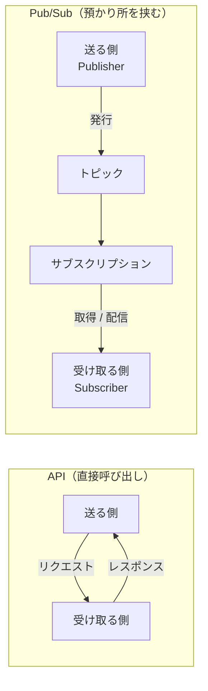
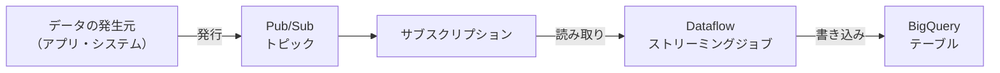

<!--
タイトル案（差し替え可）
 A. Pub/SubとAPIは何が違う？Dataflow経由でBigQueryに流す仕組みから理解する  ← 採用中
 B. Pub/Sub→Dataflow→BigQueryの流れを、API呼び出しとの違いから整理する
 C. 「APIで直接BigQueryに入れればいいのでは？」からPub/Subの役割を理解する
-->

# はじめに

インターンで、BigQuery にデータを流し込む仕組みを扱うことになりました。その経路が **Pub/Sub → Dataflow のジョブ → BigQuery** という構成で、Pub/Sub を使うことになっていました。

<!-- TODO(実体験): 「どこで手が止まったか」を1〜2文で。（例：「API で送るのと何が違うのか」と思った場面、誰かに聞いて返ってきた言葉など）。社内の固有名詞・値は出さず一般化すること -->

REST API は触ったことがあったので、最初に浮かんだ疑問は **「データを送るだけなら、API で直接 BigQuery に入れるのではダメなの？」** でした。

調べたいことは次の4つです。

- Pub/Sub って結局なに？どういう仕組み？
- API でできることと、何が違うの？
- Pub/Sub と Dataflow は、それぞれ何を担当しているの？
- 「届いたのに処理に失敗した」「2回届いた」はどうなるの？

この記事では、**公式ドキュメントと、手元で `gcloud` を叩いて確かめた範囲**で整理します。

:::note warn
筆者はメッセージングの専門家ではなく、インターンで必要になって調べた立場で書いています。内容は Google Cloud の Pub/Sub を前提にしており、他社のメッセージキュー（SQS、Kafka など）とは細部が違います。誤りがあればコメントでご指摘いただけると助かります。
:::

# 先に結論

**Pub/Sub は「送る側」と「受け取る側」の間に置く、メッセージの預かり所**です。API が「相手に直接渡して返事を待つ」なら、Pub/Sub は「預かり所に置いて、相手が取りに来るのを待つ」です。

| | API（同期呼び出し） | Pub/Sub |
| --- | --- | --- |
| 送り先 | 受け取る側を**直接**呼ぶ | **トピック**（預かり所）に置く |
| 相手が落ちていたら | 呼び出し側がエラーを受け取る | メッセージは**預かり所に残る**（保持期間内） |
| 返事 | その場で返ってくる | 基本的に返事を待たない（非同期） |
| 受け取る側が複数 | 送る側が全員を呼ぶ | トピックに置けば、各受信者が自分の分を受け取る |
| 向いている場面 | 「結果をすぐ知りたい」 | 「流れ続けるデータを、受け取る側のペースで処理したい」 |

つまり、**Pub/Sub と API は置き換え関係ではなく、「同期でやり取りするか、間に預かり所を挟むか」という設計の違い**だと理解しました。

:::note info
**意外だったこと：Pub/Sub への「送信」自体も、API 呼び出しです**
Pub/Sub にメッセージを発行する操作も、REST や gRPC の API として提供されています（`topics.publish`）。「API か Pub/Sub か」ではなく、「**呼び出す相手が、受け取る側本人か、預かり所か**」の違いです。
:::



## たとえるなら：郵便局の私書箱

表だけだとピンとこなかったので、自分なりに「郵便局」にたとえて整理しました。この記事では、この世界観で統一します。

| たとえ語 | 技術用語 | 対応のイメージ |
| --- | --- | --- |
| 差出人 | Publisher（発行側） | メッセージを作って送る側 |
| 郵便局の受付ポスト | トピック（Topic） | 差出人が投函する先。宛先の個人ではなく「ポスト」に入れる |
| 受取人ごとの私書箱 | サブスクリプション（Subscription） | トピックに紐づく、受取人専用の受け口。1つのポストに複数の私書箱をつなげられる |
| 受取人 | Subscriber（受信側） | 私書箱から手紙を取り出して処理する側 |
| 受取のサイン | ack（確認応答） | 「受け取って処理した」と伝える返事 |
| 仕分け・清書をする係 | Dataflow | 手紙の中身を整えて、次の保管場所へ運ぶ |
| 倉庫（整理して保管） | BigQuery | 最終的にデータを溜めて分析する場所 |

API のほうは、「差出人が受取人に**電話して、その場で直接伝える**」イメージです。相手が電話に出られなければ、伝わりません。

:::note info
**たとえが当てはまらない点**
実際の郵便と違い、「あとで取りに来る」方式（pull）だけでなく、Pub/Sub 側から受取人へ配信する（push）方式もあります。また、たとえはあくまで理解の入口で、技術的な事実の根拠ではありません。
:::

# わからなかったこと① Pub/Sub って結局なに？どういう仕組み？

## 調べてわかったこと

公式ドキュメントでは、Pub/Sub の基本要素は次のように説明されています（[Overview of the Pub/Sub service](https://docs.cloud.google.com/pubsub/docs/pubsub-basics)）。

- **Publisher**：メッセージを作って、トピックに発行する
- **Topic**：メッセージの送り先（ポスト）
- **Subscription**：トピックに対する「受信したい」という登録（私書箱）。**1つのトピックに複数のサブスクリプションを作れるが、1つのサブスクリプションは1つのトピックにだけ属する**
- **Subscriber**：サブスクリプションからメッセージを受け取って処理する

ポイントは次の2つでした。

- **送る側は、受け取る側の存在を知らなくていい**：ポストに入れるだけ。誰が、いつ、何人で受け取るかは関知しない
- **1つのサブスクリプションを複数の受信者で共有すると、メッセージが分担される**（公式では、各受信者がメッセージの一部を受け取り、同じメッセージは2つの受信者に渡らない、と説明されています）。一方、**サブスクリプションを分けると、全員が全メッセージを受け取れる**

後者は、たとえば「同じデータを、分析用（BigQuery）と通知用に両方使いたい」ときに、サブスクリプションを2つ作る使い方につながる、と理解しました。

## 受け取り方は2種類：pull と push

公式ドキュメントでは、サブスクリプションの配信方式として **pull**（受信側が取りに行く）と **push**（Pub/Sub が受信側の URL に送ってくる）などが説明されています（[Choose a subscription type](https://docs.cloud.google.com/pubsub/docs/subscriber)）。

| 方式 | 誰が動くか | たとえ |
| --- | --- | --- |
| pull | 受信側が「届いてる？」と取りに行く | 受取人が私書箱を見に行く |
| push | Pub/Sub が受信側の HTTPS エンドポイントに送る | 郵便局が受取人の家まで届ける |

<!-- TODO(確認): 今回のDataflowジョブがpullで読んでいるかは、筆者本人の設定を確認して書く。一般論としては「Dataflowのテンプレートはサブスクリプションから読む」と公式に書かれているが、方式の内部（pull/push）まで断定しない -->

# わからなかったこと② API でできることと、何が違うの？

## 調べてわかったこと

ここが一番の疑問でした。整理すると、違いは次の3つに集約できると理解しました。

### 違い1：相手の状態に左右されるか

API で直接呼ぶ場合、**受け取る側が落ちていたり、混んでいたりすると、呼び出した側がエラーを受け取ります**。リトライや待機は呼び出し側で作り込む必要があります。

Pub/Sub では、メッセージは**サブスクリプションに保存**されます。公式ドキュメントでは、確認応答（ack）されていないメッセージは**既定で7日間保持**され、保持期間は10分〜31日の範囲で設定できる、と説明されています（[Subscription properties](https://docs.cloud.google.com/pubsub/docs/subscription-properties)）。受け取る側が一時的に止まっていても、再開後に取りに行けるわけです。

### 違い2：返事を待つか

API は「リクエスト → レスポンス」で、結果をその場で受け取れます。Pub/Sub の発行は「預かってもらった」という確認は返ってきますが、**受取人が処理を終えたかどうかは、送る側には返ってきません**。

### 違い3：送る側と受け取る側の結びつき

API だと、送る側は**受け取る側の URL や仕様を知っている必要**があります。Pub/Sub だと、送る側は**トピックの名前だけ**を知っていればよく、受け取る側を後から増やしたり差し替えたりしても、送る側は変更しなくて済みます。

## 試してみた：預かり所の挙動を手元で確認する

「メッセージが残る」「ack しないと再配信される」を、`gcloud` で確かめてみます（Pub/Sub の利用には課金が発生しうるため、少量のメッセージで試し、終わったら削除します）。

```bash
# トピックとサブスクリプションを作る
gcloud pubsub topics create demo-topic
gcloud pubsub subscriptions create demo-sub --topic=demo-topic --ack-deadline=10

# メッセージを発行する
gcloud pubsub topics publish demo-topic --message="hello"

# 取得する（--auto-ack を付けない＝ ack しない）
gcloud pubsub subscriptions pull demo-sub

# 10秒以上待ってから、もう一度取得する
gcloud pubsub subscriptions pull demo-sub

# 今度は ack して取得する
gcloud pubsub subscriptions pull demo-sub --auto-ack

# 後片付け
gcloud pubsub subscriptions delete demo-sub
gcloud pubsub topics delete demo-topic
```

<!-- TODO(実験): 上のコマンドをユーザー本人が実行し、実際の出力（プロジェクトIDなど社内情報はマスク）と、実行日・gcloud バージョンを貼る。
     見るポイント：
       - 1回目の pull で出る ACK_ID と、ack しないまま ack deadline を過ぎたあとの2回目の pull で、同じメッセージがもう一度出るか
       - --auto-ack 付きの pull のあと、もう一度 pull すると空になるか
     追加で試すと面白い実験：サブスクリプションを作る「前」に publish したメッセージが、後から作ったサブスクリプションで取れるか（取れない、と理解しているが未確認）
     出力が手元にない間は、この節を完成させず published: false のままにする -->

# わからなかったこと③ Pub/Sub と Dataflow は何を担当しているの？

## 調べてわかったこと

今回の構成は、次の流れです。



役割を分けると、次のように理解しました。

| 担当 | 役割 | たとえ |
| --- | --- | --- |
| Pub/Sub | データを**受け止めて、溜めて、受け取る側に渡す** | 私書箱 |
| Dataflow | データを**読み取って、変換して、書き込む**処理を実行する | 仕分け・清書係 |
| BigQuery | データを**保管して、分析する** | 倉庫 |

Pub/Sub は「運ぶ・預かる」だけで、**データの中身を加工する場所ではありません**。加工（形式の整形、不要項目の除去、集計など）は Dataflow の役割、というのが自分の理解です。

Dataflow には、この組み合わせ用のテンプレート **「Pub/Sub Subscription to BigQuery」** が公式に用意されています。公式ドキュメントでは、サブスクリプションから JSON のメッセージを読み取り、BigQuery のテーブルに書き込むストリーミングパイプラインで、**出力先のテーブルは事前に存在している必要があり、スキーマは JSON と合っている必要がある**、と説明されています（[Pub/Sub Subscription to BigQuery template](https://docs.cloud.google.com/dataflow/docs/guides/templates/provided/pubsub-subscription-to-bigquery)）。

<!-- TODO(確認): 今回のジョブが上のテンプレートを使っているのか、自前のパイプラインなのかは筆者本人の設定を確認して書く。テンプレートでない場合は、この段落を「テンプレートもある」程度に短くする -->

## 「Dataflow を挟まず、Pub/Sub から直接 BigQuery」もできる

調べていて意外だったのは、Pub/Sub には **BigQuery サブスクリプション**という、Dataflow を使わずに BigQuery へ直接書き込む仕組みがあることです（[BigQuery subscriptions](https://docs.cloud.google.com/pubsub/docs/bigquery)）。

| | Dataflow 経由 | BigQuery サブスクリプション |
| --- | --- | --- |
| 変換・加工 | 自由にできる（集計、マスキングなど） | 軽い変換が中心（公式では、複雑な処理は Dataflow が向くとされている） |
| 配信保証 | テンプレートは exactly-once を既定とする（公式の説明） | at-least-once のみ（公式の説明） |
| 運用するもの | Dataflow ジョブ | なし（サブスクリプション設定のみ） |

「そのまま入れるだけなら直接、加工や重複排除が必要なら Dataflow」という使い分けだと理解しました。

<!-- TODO(実体験): なぜ今回 Dataflow を挟む構成になったのか、筆者本人が聞いた・知っている理由を書く（変換が必要だった／重複を避けたかった／既存の構成に合わせた、など）。わからなければ「わかっていない」と正直に書く。社内の固有名詞は出さない -->

# わからなかったこと④ 「処理に失敗した」「2回届いた」はどうなるの？

## 調べてわかったこと

Pub/Sub の配信は、既定では **at-least-once（少なくとも1回）** で、**順序の保証もありません**（[Subscription overview](https://docs.cloud.google.com/pubsub/docs/subscription-overview)）。

流れは次のとおりです。

1. Pub/Sub が受信者にメッセージを渡す
2. 受信者は、処理したら **ack（受取のサイン）** を返す
3. **ack deadline（既定は10秒、最大600秒）** 以内に ack が返らないと、メッセージは「未処理」に戻り、**再配信**される

そのため、次の2点が大事だと理解しました。

- **同じメッセージが2回届くことがある**：ack が間に合わなかった、などで。受け取る側は、**2回処理しても結果が変わらない作り（冪等）**にしておく必要がある、と公式にも書かれています
- **処理が終わる前に ack しない**：先に ack すると、処理に失敗しても再配信されない（公式の説明）

Dataflow のテンプレートが「exactly-once を既定とする」と書かれているのは、この重複を**パイプライン側で取り除く**ためだと理解しました。たとえるなら、「同じ手紙が2通届いても、仕分け係が気づいて1通だけ倉庫に入れる」イメージです。

:::note info
**たとえが当てはまらない点**
Pub/Sub 自体にも exactly-once 配信のオプションはありますが、公式では pull サブスクリプションのみ対応・リージョン内でのみ保証、と説明されています。「必ず1回」と覚えるのではなく、条件つきの機能と理解しました。
:::

<!-- TODO(実体験): 実際に重複・失敗・遅延などを経験したか、あれば書く。なければこの節はこのままで問題ない -->

# まだ腑に落ちていないこと

- **ストリーミングの Dataflow ジョブが、どうやって Pub/Sub から読んでいるか**（pull なのか、内部でどう ack しているのか）：公式のテンプレートの説明は読みましたが、内部の挙動までは追えていません
- **失敗したメッセージの行き先（dead-letter）の設計**：公式にはデッドレター用のトピックやテーブルの仕組みがあるようですが、今回は触っていません
- **料金の見積もり**：Pub/Sub、Dataflow、BigQuery それぞれに課金があり、構成ごとにどれだけ違うかは試算できていません

# まとめ

- **Pub/Sub** は、送る側と受け取る側の間に置く**メッセージの預かり所**（郵便局の私書箱）。送る側は、受け取る側を知らなくていい
- **API との違い**は、「相手を直接呼んで返事を待つ」か「預かり所に置いて、相手のペースで取りに来てもらう」か。置き換え関係ではなく、設計の選択。発行自体も API 呼び出し
- **今回の構成**では、Pub/Sub が「受け止めて預かる」、Dataflow が「読んで、変換して、書く」、BigQuery が「保管して分析する」という分担だと理解した
- **配信は既定で at-least-once**。2回届く前提で、受け取る側（または Dataflow）が重複を扱う。ack は処理が終わってから

「API で直接入れればいいのでは？」という最初の疑問は、「**受け取る側が止まっていても、データを落とさず、後から処理できるようにするための間の置き場**」と言い換えると、整理しやすくなりました。同じところで手が止まっている方の参考になれば幸いです。

## 参考

- [Overview of the Pub/Sub service（Google Cloud）](https://docs.cloud.google.com/pubsub/docs/pubsub-basics)
- [Subscription overview（Pub/Sub）](https://docs.cloud.google.com/pubsub/docs/subscription-overview)
- [Subscription properties（Pub/Sub）](https://docs.cloud.google.com/pubsub/docs/subscription-properties)
- [Choose a subscription type（Pub/Sub）](https://docs.cloud.google.com/pubsub/docs/subscriber)
- [BigQuery subscriptions（Pub/Sub）](https://docs.cloud.google.com/pubsub/docs/bigquery)
- [Pub/Sub Subscription to BigQuery template（Dataflow）](https://docs.cloud.google.com/dataflow/docs/guides/templates/provided/pubsub-subscription-to-bigquery)
