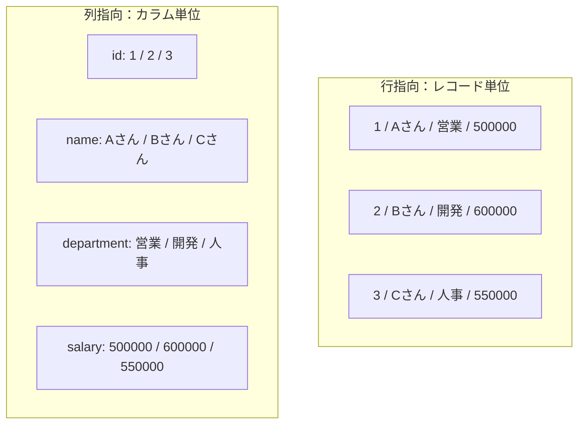
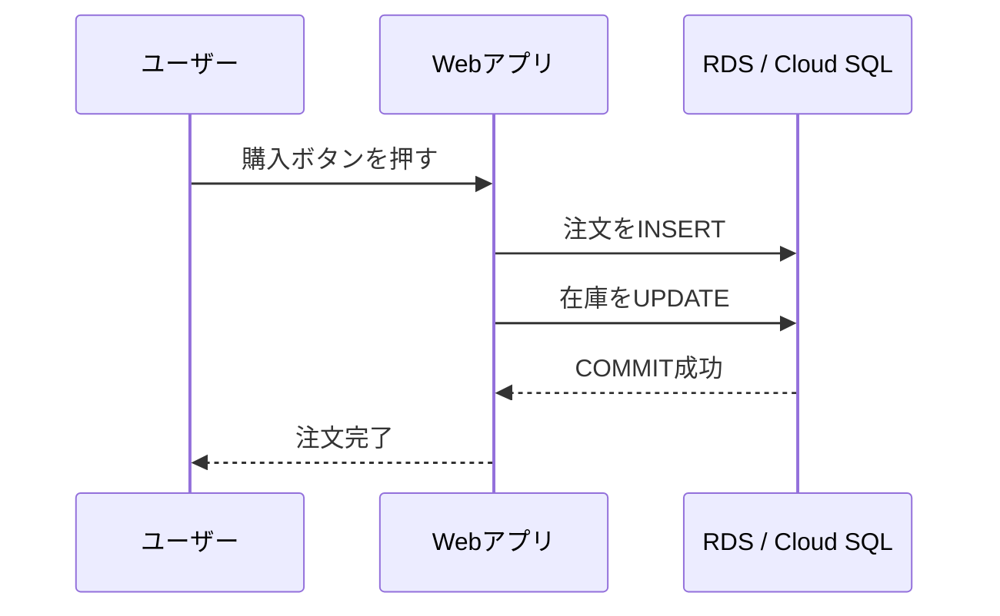
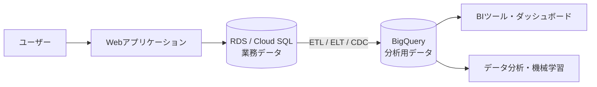
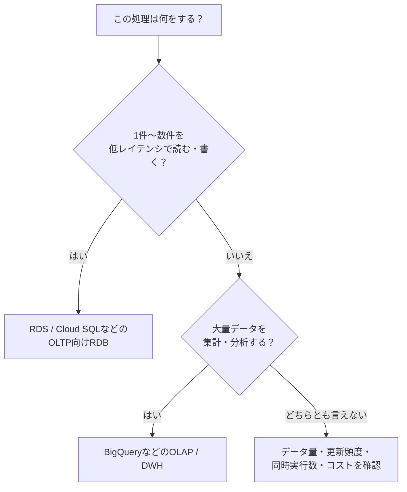
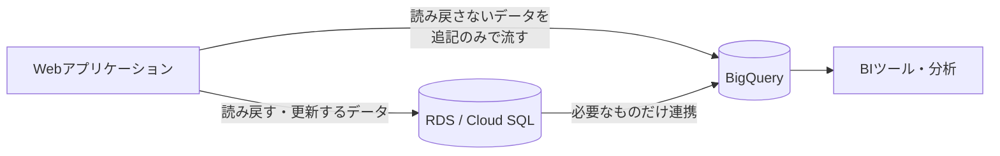

# はじめに

普段はバックエンドエンジニアとして、Amazon RDS や Cloud SQL（MySQL / PostgreSQL）を使ったWebアプリ開発をしています。最近、ログ分析やBIツール連携で BigQuery に触れる機会があり、こんな疑問が出てきました。

- どちらも SQL で操作できるのに、何が違うの？
- なんで BigQuery では `SELECT *` を避けろと言われるの？
- `UPDATE` や `JOIN` は、RDB と同じ感覚で使っていいの？
- アプリのデータは、BigQueryに置かないのはなぜ？

「BigQuery は列指向で分析向き」という説明は何度も目にしましたが、**その説明だけでは上の疑問がつながりませんでした**。そこで調べてみたところ、「行指向 / 列指向」と「OLTP / OLAP」の2つを押さえると、疑問がまとめて整理できたので、わかった範囲を共有します。

:::note warn
筆者はBigQueryの専門家ではなく、調べて理解した立場で書いています。誤りや認識のズレがあれば、コメントでご指摘いただけると助かります!!
:::

この記事でいう RDS / Cloud SQL は、MySQL や PostgreSQL のような一般的なRDBを指します。

# 先に結論

RDS / Cloud SQL と BigQuery は、どちらが優れているかではなく、**得意な仕事が違います**。

```text
RDS / Cloud SQL = アプリケーションの「今」を、1件ずつ正確に処理する
BigQuery        = 溜まったデータから「傾向」を、まとめて大規模に分析する
```

| 比較項目 | RDS / Cloud SQL | BigQuery |
| --- | --- | --- |
| 主な役割 | Webアプリの業務データ | 大量データの分析（DWH） |
| 処理の種類 | OLTP | OLAP |
| 得意な処理 | 1件の検索・登録・更新・削除 | 大量データの集計・分析 |
| 重視する性能 | 低レイテンシ、同時実行、整合性 | スループット、大規模スキャン |

# わからなかったこと①：同じSQLなのに、何が違うの？

最初の壁がこれでした。SQL が書けるなら同じように使えそうなのに、なぜ使い分けるのか、がピンときませんでした。

答えは、**データの並べ方（保存の仕方）が違う**ことにありました。

次の `employees` テーブルで考えます。

| id | name | department | salary |
| ---: | --- | --- | ---: |
| 1 | Aさん | 営業 | 500000 |
| 2 | Bさん | 開発 | 600000 |
| 3 | Cさん | 人事 | 550000 |

**行指向**は、1件分の値をまとめて近くに置きます。

```text
1, Aさん, 営業, 500000  ← 1行目
2, Bさん, 開発, 600000  ← 2行目
3, Cさん, 人事, 550000  ← 3行目
```

**列指向**は、同じ列の値をまとめて置きます。

```text
id:         1,       2,       3
name:       Aさん,   Bさん,   Cさん
department: 営業,    開発,    人事
salary:     500000,  600000,  550000
```



これで、得意な処理の違いが説明できます。

- **1人分の情報がほしい**（`WHERE id = 2`）→ 行指向なら、その1行をまとめて読めば済む
- **全社員の平均給与がほしい**（`AVG(salary)`）→ 列指向なら、`salary` 列だけ読めば済む。`name` などは読まなくていい

さらに、同じ列には似た種類の値が並ぶので、圧縮もしやすいそうです。

:::note info
「RDSは必ず行指向」「BigQueryは列指向だから常に速い」と単純化するのは危ないようです。インデックス、パーティション、データ量、クエリの内容で実際の性能は変わります。BigQueryの速さも、列指向だけでなく分散処理など複数の仕組みの組み合わせだと理解しています。
:::

# わからなかったこと②：OLTP / OLAP という言葉がピンとこない

OLAPは聞いたことがあったのですが、OLTPって何！？となりました。自分なりに言い換えると、こうなります。

| | OLTP | OLAP |
| --- | --- | --- |
| 正式名称 | Online Transaction Processing | Online Analytical Processing |
| 言い換え | アプリが日々行う、細かい読み書き | 溜まったデータの集計・分析 |
| 1回に触る行数 | 1行〜数行 | 大量の行 |
| 例 | 注文登録、在庫の減算、会員情報の更新 | 月別売上の集計、アクセスログ分析 |
| 重視すること | 速さ（低レイテンシ）、整合性、同時実行 | 大量データを効率よく読むこと |



つまり、**「1行を触る処理が中心」なら行指向のRDB（OLTP）、「大量の行をなめる処理が中心」なら列指向のBigQuery（OLAP）**、という対応でした。ここで①の行指向・列指向の話とつながって、やっと腑に落ちました。

# わからなかったこと③：なぜ `SELECT *` を避けるの？

①がわかると、これも説明できます。

列指向では、**読む列が多いほど読み込み量が増えます**。BigQuery（オンデマンド課金）では、この処理量が料金にも効いてきます。`SELECT *` は全列を読んでしまうので、分析に不要な列まで課金対象になります。

```sql
-- 必要な列だけを指定する
SELECT
  order_date,
  prefecture,
  amount
FROM `my-project.analytics.orders`
WHERE order_date >= '2026-01-01';
```

自分が特に意外だったのは、**`LIMIT 10` を付けても、読み込み量は減るとは限らない**ことです。`LIMIT` は「返す行数」を絞るだけで、「読む量」を自動で減らすわけではありません。

実行前に「推定処理バイト数」を確認する癖をつけるのが良さそうです。必要なら最大請求額（Maximum bytes billed）で上限も設定できます。

## 読む量を減らす仕組み：パーティションとクラスタリング

`SELECT *` を避けるのは「列」を絞る話でした。「行（範囲）」を絞る仕組みとして、次の2つがあります。

- **パーティション**：日付などの単位でテーブルを分割する。対象期間以外を読まずに済む
- **クラスタリング**：よく絞り込む列（`customer_id` など）の値でデータを整理する

```text
パーティション：2026-01、2026-02、2026-03 ...
                  ↓
クラスタリング：customer_id / product_id などでデータを整理
```

ただし、パーティション列に関数をかけると絞り込みが効きにくくなることがあるそうです。また、どの列を設定すべきかは実際のクエリ次第で、設定すれば必ず速くなるわけではないようです。

# わからなかったこと④：`UPDATE` や `JOIN` はそのまま使っていいの？

「BigQueryは更新できない」「JOIN禁止」という話を聞いたことがあり、本当なのか気になっていました。

調べた結果、**どちらも使えます**。ただし使い方に向き不向きがあります。

- `UPDATE` / `DELETE` / `MERGE`（DML）は使える
  - ただし、1件ずつ頻繁に更新する使い方はOLTP向けのRDBほどの低レイテンシにならない
  - 一般的には、追記する、まとめてロードする、集計テーブルを作り直す、必要なときだけ `MERGE` する、といった設計になる
- `JOIN` も普通に使える
  - ただし、巨大なテーブル同士を毎回JOINする設計は避け、分析用にあらかじめまとめたテーブルを持つこともある
  - `STRUCT` / `ARRAY` のネスト構造で読み取りを効率化する手もある

```text
RDB：orders ── JOIN ── customers ── JOIN ── products

DWH：分析に必要な注文・顧客・商品情報をまとめた分析用テーブル
```

つまり「できない」ではなく、**「毎回やるとコストや速度で不利になりうるので、設計で工夫する」**が正確なようです。常に非正規化すべき、という話でもなく、更新頻度やクエリの複雑さを見て判断するもの、と理解しました。

# わからなかったこと⑤：結局、どっちに保存すればいいの？

答えは「どちらか」ではなく**「両方を役割分担させる」**でした。



ECサイトなら次のような分担です。

- 注文の確定、在庫の減算、会員情報の更新 → RDS / Cloud SQL
- 月別売上の集計、購入傾向の分析 → BigQuery

アプリの状態管理にBigQueryをRDBの代わりに使うのではなく、RDBを「正」として、分析用にBigQueryへ連携する構成がよく使われるようです。分析の重い処理が、業務のトランザクションに影響しないようにするためです。

迷ったときは、次の順で考えると整理しやすいです。



## 補足：DBに保存しなくていいデータは、BigQueryに直接流す選択肢もある

ここまでは「RDBを正として、BigQueryに連携する」構成でした。ただ、調べていて、**データの種類によっては、RDBを通さずBigQueryにだけ書く**という選択肢もあることがわかりました。

判断の軸は、次の2つです。

- アプリが、後からそのデータを**読み戻したり更新したりする**か
- 将来、**集計・分析したい**か

| | アプリが読み戻す・更新する | アプリは読み戻さない |
| --- | --- | --- |
| **将来分析したい** | RDBに保存し、BigQueryにも連携する | **BigQueryに直接流す（追記のみ）** |
| **分析もしない** | RDBに保存する | そもそも保存しない |

たとえば、操作ログ、クリックなどのイベント、API呼び出しの履歴のように、**アプリ自身は読み返さないけれど、あとで分析できると嬉しい**データが当てはまります。



### なぜBigQueryのほうが安く済みそうなのか

自分の理解では、次の理由からです。

- RDS / Cloud SQL は、**使っていなくてもインスタンスが起動している間は費用がかかります**。分析のために溜めるだけの大量データを置くと、割高になりやすそうです
- BigQuery は、データの保存量に応じたストレージ料金と、クエリを実行したときの処理量に応じた料金（オンデマンドの場合）が基本です。長期間更新されないデータは、ストレージ料金が下がる区分もあります
- 分析用の重いクエリを本番のRDBに流さなくて済むので、アプリの性能に影響しません

:::note warn
「安い」はあくまで**溜めるだけ・たまに分析する**場合の話です。頻繁に大量のクエリを実行すると、スキャン量の費用が増えて逆転する可能性があります。料金は変わるので、実際のデータ量とクエリ頻度で、公式の料金表をもとに試算するのがよさそうです。
:::

### 垂れ流しにするときに気をつけたいこと

- **あとから1件ずつ読み戻す・直す用途には向きません**。この用途が出てきそうなら、最初からRDBに置きます
- 流したデータの修正はできなくはないものの、設計の中心にはしにくいです（④の話）。**流す前に、どの項目を流すかを決めておく**必要がありそうです。個人情報を含めるかどうかは特に注意が必要です
- 分析のたびにスキャン量が課金されるので、日付などでパーティション分割しておくと、読む範囲を絞れます（③の話）
- 流し込みの失敗や、リトライによる重複をどう扱うかも考えておく必要がありそうです

自分が今実装している機能でも、**DBには保存せず、BigQueryへ直接流し込む（垂れ流す）方針**にしました。アプリ側で読み戻す必要がなく、将来分析できればよいデータだったためです。「SQLが書けるからとりあえずDBに入れる」ではなく、**このデータは読み戻すのか、分析するのか**で保存先を決めるのが大事だと感じました。

# 同じ要件を書き分けるとこうなる

**RDS / Cloud SQL：1件の注文を取得する**

```sql
SELECT id, customer_id, status, total_amount
FROM orders
WHERE id = 12345;
```

主キーやインデックスで、必要な1件を素早く取ります。

**BigQuery：月別・地域別に売上を集計する**

```sql
SELECT
  DATE_TRUNC(order_date, MONTH) AS order_month,
  prefecture,
  SUM(total_amount) AS total_amount,
  COUNT(*) AS order_count
FROM `my-project.analytics.orders`
WHERE order_date >= '2026-01-01'
  AND order_date < '2027-01-01'
GROUP BY order_month, prefecture
ORDER BY order_month, total_amount DESC;
```

大量の注文を読んで、期間・地域ごとに集計します。典型的なOLAPクエリです。

# まだ腑に落ちていないこと

- パーティションやクラスタリングを、実際のテーブルでどう設計すればよいか（実際のクエリで試して確かめたい）
- RDBからBigQueryへのデータ連携（ETL / ELT / CDC）の具体的な選び方
- BigQueryへ直接流し込む具体的な方法（ストリーミング挿入、Storage Write API、Pub/Sub経由など）の違いと選び方

ここは調べきれていないので、詳しい方がいればぜひ教えてください。

# まとめ

- RDS / Cloud SQL は**行単位の読み書き・低レイテンシ・整合性**を重視するOLTP向け
- BigQuery は**列単位のスキャン・大量集計**を重視するOLAP向け
- `SELECT *` を避けるのは、列指向では**読む列が増えるほど処理量が増える**から
- `UPDATE` も `JOIN` も使える。ただし**頻度・データ量・クエリパターンを見て設計する**
- 実際には、RDBを正としてBigQueryに連携し、**役割分担**させる構成が多い
- アプリが読み戻さず、将来の分析だけしたいデータは、**RDBに保存せずBigQueryに直接流す**選択肢もある。溜めるだけなら安く済みやすい

「SQLが書けるから同じように使える」ではなく、**その処理は「1件を素早く扱いたい」のか、「大量データから傾向を見つけたい」のか**を最初に考えると、使い分けとクエリの書き方が整理しやすくなると感じました。
