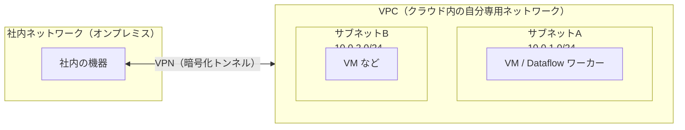

<!--
タイトル案（差し替え可）
 A. VPC・サブネット・VPNの関係を整理する（Dataflowのネットワーク設定で迷った話）  ← 採用中
 B. DataflowでVPCとサブネットどっちを指定する？VPN・VPCとの違いから理解する
 C. 「VPCとサブネットの違い」がわからず設定で手が止まった人へ（GCP / Dataflow）
-->

# はじめに

インターンで、BigQuery に関わる **Dataflow** のジョブ設定が必要になり、設定ファイル（`.cue`）を書くことになりました。

その中に、**ネットワークを指定する項目**がありました。ここで「VPC を指定するのか、サブネットを指定するのか、どれが適切なのか」を選ぶ必要があり、そもそも **VPC とサブネットって何が違うんだっけ？** というところで手が止まりました。ついでに名前が似ている **VPN** も、VPC と何が違うのか分かっていませんでした。

<!-- TODO(実体験): 手が止まった具体的な場面を1〜2文で。（例：項目名・エラー・誰かに聞いて返ってきた言葉など）。社内の固有名詞・値は出さず一般化すること -->

調べたいことは次の4つです。

- VPC って結局なに？
- サブネットは VPC とどう違うの？
- VPN は VPC と何が違うの？（名前が似ていて混ざる）
- Dataflow の設定では、VPC とサブネットのどちらを指定すればいいの？

この記事では、上の疑問を **公式ドキュメントと、手元で `gcloud` を叩いて確かめた範囲** で整理します。

:::note warn
筆者はネットワークの専門家ではなく、インターンで必要になって調べた立場で書いています。内容は Google Cloud（GCP）を前提にしています。AWS など他のクラウドでは細部が違うため、違いが出やすい点は補足します。誤りがあればコメントでご指摘いただけると助かります。
:::

# 先に結論

3つの用語は、**同じ「ネットワーク」の話でも、役割が別のもの**だと理解しました。

- **VPC**：クラウドの中に作る、自分専用の仮想ネットワーク全体（箱）
- **サブネット**：VPC の IP アドレス範囲を区切った区画（箱の中の区画）
- **VPN**：離れたネットワーク同士を、暗号化したトンネルでつなぐ仕組み（箱と箱、または社内と箱をつなぐ通路）



| 用語 | 正式名称 | 何の単位か | 一言でいうと |
| --- | --- | --- | --- |
| VPC | Virtual Private Cloud | ネットワーク全体 | 自分専用の仮想ネットワーク |
| サブネット | Subnetwork | IP アドレス範囲の区画 | VPC を区切った区画 |
| VPN | Virtual Private Network | 2つのネットワーク間の接続 | 暗号化したトンネル |

つまずきの原因は、**VPC と VPN が「ネットワーク」という言葉でひとまとめに見えること**と、**サブネットが「VPC の中身」であることを知らなかったこと**でした。

## たとえるなら：オフィスビル

表だけだとピンとこなかったので、自分なりに「オフィスビル」にたとえて整理しました。この記事では、この世界観で統一します。

| たとえ語 | 技術用語 | 対応のイメージ |
| --- | --- | --- |
| ビル全体（入館証がないと入れない自社ビル） | VPC | 自分専用の仮想ネットワーク |
| フロア（部署ごとの区画） | サブネット | IP アドレスの範囲を区切った区画 |
| 部屋番号・座席番号 | IP アドレス | 区画の中で一台ごとに割り当てられる番号。機器に固有ではなく、いる場所（ネットワーク）で決まる |
| 他拠点とビルを結ぶ、暗号化された専用通路 | VPN | 離れたネットワーク同士をつなぐトンネル |
| 入館ゲート | ファイアウォール | 通してよい通信を決めるルール |

:::note info
**たとえが当てはまらない点**
実際の GCP では、VPC は特定の地域に属さない（グローバル）一方、サブネットは**リージョン単位**で作ります（公式ドキュメント：[VPC networks](https://docs.cloud.google.com/vpc/docs/vpc)）。「ビルの1フロアは1か所」というたとえでは、このあたりが表現しきれません。また、たとえはあくまで理解の入口で、技術的な事実の根拠ではありません。
:::

# わからなかったこと① VPC って結局なに？

## 調べてわかったこと

**VPC（Virtual Private Cloud）** は、クラウドの中に作る**自分専用の仮想ネットワーク**です。たとえるなら「自社専用のビル」で、他の会社（他のプロジェクトや利用者）のビルとは基本的に分かれています。

GCP の公式ドキュメントでは、次のように説明されています（[VPC networks](https://docs.cloud.google.com/vpc/docs/vpc)）。

- VPC ネットワークは**グローバルなリソース**で、特定のリージョンやゾーンには属さない
- 経路（ルート）やファイアウォールルールも、VPC ネットワークに紐づく

「VPC の中に VM や Dataflow のワーカーを置くと、その VM 同士が内部の IP アドレスで通信できる」というのが、基本的な使われ方だと理解しました。

# わからなかったこと② サブネットは VPC とどう違うの？

## 調べてわかったこと

**サブネット（Subnetwork）** は、VPC の IP アドレスの範囲を区切った区画です。たとえるなら、ビルの中の「フロア」です。

ポイントは次の2つです。

- **サブネットは VPC の中にある**（VPC ＞ サブネット という包含関係）
- **VM などは、実際にはサブネットの IP アドレス範囲から番号をもらう**（VPC に直接ではなく、サブネットの範囲の中で）

GCP の公式ドキュメントでは、サブネットは**リージョン単位のリソース**で、IP アドレス範囲を持つと説明されています（[Create and manage VPC networks](https://docs.cloud.google.com/vpc/docs/using-vpc)）。

IP アドレス範囲は `10.0.1.0/24` のように CIDR という書き方で表します。ここでは詳しく踏み込まず、「`/24` の部分が大きいほど、区画が狭い（使えるアドレスが少ない）」とだけ覚えておけば十分だと理解しました。

## auto モードと custom モード

VPC には、サブネットの作られ方で2種類あります（[Create and manage VPC networks](https://docs.cloud.google.com/vpc/docs/using-vpc)）。

| モード | サブネットの作られ方 |
| --- | --- |
| auto モード | 各リージョンに、サブネットが自動で1つずつ作られる |
| custom モード | 最初はサブネットが0個。自分で必要なものを作る |

プロジェクトを作ると最初からある `default` という名前のネットワークが、auto モードの VPC です。

## 試してみた：自分のプロジェクトの VPC とサブネットを見る

実際に、プロジェクトにある VPC とサブネットを `gcloud` で見てみました。

```bash
# VPC の一覧
gcloud compute networks list

# サブネットの一覧（どの VPC・どのリージョンにあるかが出る）
gcloud compute networks subnets list

# 1つのサブネットの詳細
gcloud compute networks subnets describe SUBNET_NAME --region=REGION
```

<!-- TODO(実験): 上の3コマンドをユーザー本人が実行し、実際の出力（プロジェクトIDなど社内情報はマスク）と、実行日・gcloud バージョンを貼る。
     見るポイント：
       - NETWORKS の SUBNET_MODE が AUTO か CUSTOM か
       - サブネットの REGION と RANGE（ipCidrRange）
       - 1つの VPC の下にリージョン違いのサブネットが並んでいること（＝VPCはグローバル、サブネットはリージョン）
     出力が手元にない間は、この節を完成させず published: false のままにする -->

# わからなかったこと③ VPN は VPC と何が違うの？

## 調べてわかったこと

**VPN（Virtual Private Network）** は、**離れた2つのネットワークを、暗号化した通信路（トンネル）でつなぐ仕組み**です。たとえるなら、ビルと他拠点を結ぶ「暗号化された専用通路」です。

VPC が「ネットワークそのもの（箱）」であるのに対して、VPN は「箱と箱をつなぐ**接続**」です。単位が違うので、並べて比較するものではない、というのが自分の理解です。

GCP の場合は **Cloud VPN** というサービスがあり、公式ドキュメントでは、**IPsec VPN 接続で、相手側のネットワーク（オンプレミスなど）を VPC ネットワークに安全に拡張する**ものと説明されています（[Cloud VPN overview](https://docs.cloud.google.com/vpn/docs/concepts/overview)）。通常は公共のインターネットを経由して、通信を暗号化して届けます。

## 名前が似ていて混ざる理由

どちらも頭が「V」と「P」で、「仮想」「プライベート」という意味の言葉を含みます。ただ、次のように指しているものが違います。

| | VPC | VPN |
| --- | --- | --- |
| Virtual | 仮想 | 仮想 |
| Private | 自分専用 | 自分専用（の通信路） |
| 最後の C / N | Cloud（クラウド上のネットワーク） | Network（ネットワーク同士をつなぐ通信路） |
| 役割 | ネットワークを**作る** | ネットワークを**つなぐ** |

:::note info
**今回の設定には、VPN は出てきませんでした**
自分の場合、Dataflow の設定で必要だったのは VPC とサブネットの選択だけで、VPN は直接の関係がありませんでした。ただ、「社内ネットワークから VPC の中のリソースにアクセスしたい」といった場面で VPN が登場する、という位置づけだと理解しています。
:::

<!-- TODO(実体験): 実際に VPN が設定に出てきたか／出てこなかったかを、筆者本人の経験で確認して差し替える（上のnoteは筆者の説明から推測した仮置き） -->

# わからなかったこと④ Dataflow では VPC とサブネットのどちらを指定するの？

ここが、最初に手が止まったところです。

## 調べてわかったこと

Dataflow の公式ドキュメントでは、`network`（VPC）と `subnetwork`（サブネット）の2つのパラメータが用意されています。そして、次のように書かれています（[Specify a network and subnetwork](https://docs.cloud.google.com/dataflow/docs/guides/specifying-networks)）。

- どちらを指定すればいいか迷ったら、**サブネットだけを指定する**。そうすると、VPC（network）は暗黙的に決まる
- どちらも指定しない場合は、`default` という名前の auto モード VPC を使うものとして扱われる。`default` がないプロジェクトでは、別のネットワークかサブネットを指定する必要がある
- サブネットは、**Dataflow のワーカーを動かすゾーンと同じリージョン**のものを選ぶ必要がある
- サブネットが custom モード VPC にある場合は、**サブネットの指定が必須**
- Shared VPC（他のプロジェクトのネットワークを共有して使う構成）では、サブネットをフルの URL で指定する必要がある

ここまで読んで、「VPC とサブネットの選択」の意味がつながりました。

- **VPC を指定する**：「このビルの中で動かして」と指定する。どのフロア（サブネット）に置くかは、Dataflow に任せる
- **サブネットを指定する**：「このビルの、このフロアに置いて」と指定する

ビルだけ指定すると、その中のどのフロアになるかは自分では選べません。custom モードの VPC では、そもそもフロアが自動では存在しないので、フロアの指定が必須になる、と理解しました。

| 指定するもの | たとえ | いつ使うか |
| --- | --- | --- |
| VPC（`network`） | ビルだけ指定する | auto モードの VPC で、細かい場所にこだわらないとき |
| サブネット（`subnetwork`） | フロアまで指定する | custom モード、リージョンやアドレス範囲を明示したいとき、Shared VPC など |

:::note info
**たとえが当てはまらない点**
実際には、サブネットを指定すれば VPC は自動で決まります（VPC とサブネットを両方指定する必要はありません）。「フロアを指定すれば、ビルは自動で分かる」という関係です。
:::

## 私の場合はどうだったか

<!-- TODO(実体験): インターンで実際にどちらを選んだか、その理由（custom モードだった／リージョンを合わせる必要があった／チームの既存の設定に合わせた、など）を筆者本人の言葉で書く。
     社内のネットワーク名・サブネット名・IPレンジなどの固有値は書かない。
     .cue でどのような項目に指定したかは、一般化できる範囲で。 -->

## 外部IPなしで動かすとき：Private Google Access

公式ドキュメントには、ワーカーに**外部 IP アドレスを持たせない**（`public IP` をオフにする）構成では、そのネットワークまたはサブネットで **Private Google Access** を有効にする必要がある、とも書かれています（[Dataflow のネットワークとファイアウォール](https://docs.cloud.google.com/dataflow/docs/guides/routes-firewall)）。

自分は今回の設定でここまでは踏み込んでいませんが、サブネットの設定項目（`privateIpGoogleAccess`）として `describe` の出力に出てくるはずなので、「サブネットを選ぶ」ことの意味の一つだと理解しました。

<!-- TODO(確認): 実際の設定で Private Google Access / 外部IPなし の構成にしたかを本人に確認し、触れていないなら、この節は短く残すか削除する -->

# まだ腑に落ちていないこと

- **サブネットの IP アドレス範囲（CIDR）の決め方**：どのくらいの大きさにすれば、Dataflow のワーカー台数に足りるのか。公式にもガイドがありますが、実際に計算して試せていません
- **Shared VPC の仕組み**：他のプロジェクトのネットワークを使う構成は、今回は「フル URL で指定する」と覚えただけで、仕組みまでは理解できていません
- **AWS との違い**：公式の説明では、GCP の VPC はグローバル・サブネットはリージョン単位ですが、AWS では、VPC はリージョン単位、サブネットはアベイラビリティゾーン単位だったと記憶しています。この点は今回は裏取りしていないので、AWS 前提で読む方は公式を確認してください

<!-- TODO(確認): 上の「AWSとの違い」は未裏取り。公式（AWS VPC ドキュメント）で確認できなければ、この項目を削除する -->

# まとめ

- **VPC** は、クラウドの中の自分専用の仮想ネットワーク全体（ビル全体）。GCP では**グローバル**なリソース
- **サブネット** は、VPC の IP アドレス範囲を区切った区画（フロア）。GCP では**リージョン単位**で、VM や Dataflow ワーカーは、サブネットの範囲から IP アドレスをもらう
- **VPN** は、離れたネットワーク同士を暗号化トンネルでつなぐ仕組み（他拠点との専用通路）。VPC を「作る」ものではなく、つなぐもの
- Dataflow では、迷ったら**サブネットだけを指定**すれば、VPC は自動で決まる。サブネットは、ワーカーを動かすゾーンと**同じリージョン**のものを選ぶ。custom モード VPC では、サブネットの指定が必須

「VPC とサブネットのどちらを選ぶか」という疑問は、「ビルとフロアのどちらで場所を指定するか」と言い換えると、整理しやすくなりました。同じところで手が止まっている方の参考になれば幸いです。

## 参考

- [VPC networks（Google Cloud）](https://docs.cloud.google.com/vpc/docs/vpc)
- [Create and manage VPC networks（Google Cloud）](https://docs.cloud.google.com/vpc/docs/using-vpc)
- [Cloud VPN overview（Google Cloud）](https://docs.cloud.google.com/vpn/docs/concepts/overview)
- [Specify a network and subnetwork（Dataflow）](https://docs.cloud.google.com/dataflow/docs/guides/specifying-networks)
- [Dataflow のネットワークとファイアウォール（Dataflow）](https://docs.cloud.google.com/dataflow/docs/guides/routes-firewall)
